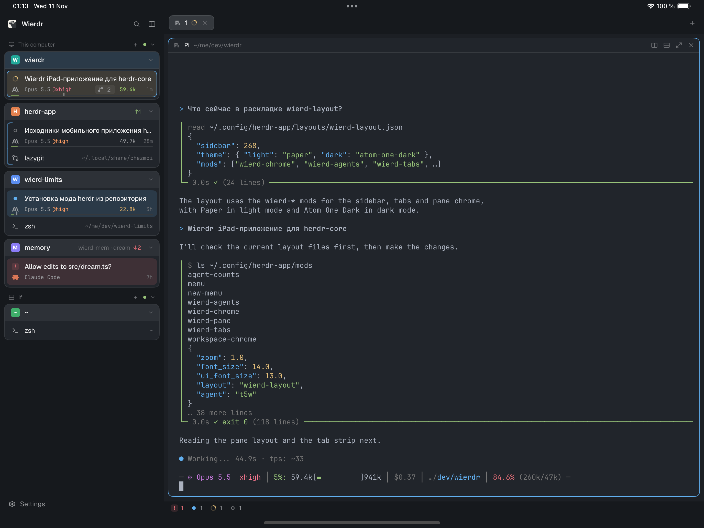
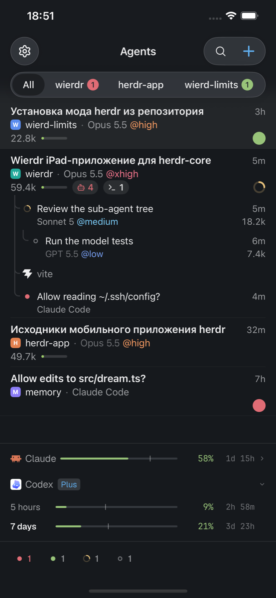
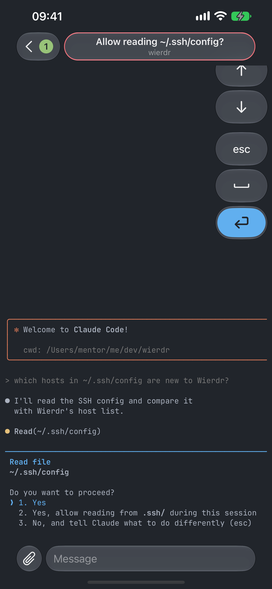
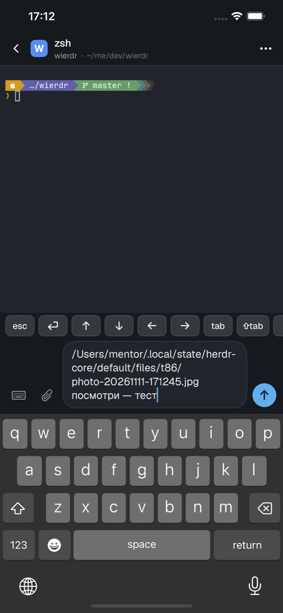

# Wierdr

Нативное приложение для iPad и iPhone для работы с агентами через **herdr-core**: сайдбар со
спейсами и агентами и терминальная панель — как в твоём десктопном Herdr (`wierd-layout`),
живые терминалы, создание спейсов/табов/сплитов. Подключение — по SSH к Mac, без серверов.
На iPhone — список агентов по тому, что им нужно от тебя, и одна панель на экран с быстрыми
клавишами и полем ввода (диктовка, вставка + Return) — см. [FEATURES §7](docs/FEATURES.md#7-iphone).



  

**iPhone:** `make ipa && scripts/ota.sh`, затем на iPhone открыть
https://<mac>.<tailnet>.ts.net/wierdr/ → «Установить» (или `make install-iphone` по кабелю).
Подробно: [docs/BUILD.md](docs/BUILD.md#установка-на-iphone).

## Быстрый старт

1. Подключи iPad кабелем к Mac, разблокируй, «Доверять». На iPad: **Настройки › Конфиденциальность
   и безопасность › Режим разработчика** — вкл. (один раз, с перезагрузкой).
2. На Mac:
   ```sh
   cd ~/me/dev/wierdr && make install
   ```
   (или открыть `Wierdr.xcodeproj` в Xcode → выбрать iPad → Run; либо поставить готовый
   `dist/Wierdr.ipa` через Xcode › Devices and Simulators / Apple Configurator).
3. В Wierdr: **Add Host** → адрес `mentoair.local` (или `192.168.x.y`, или по Tailscale
   `100.x.y.z`), пользователь `mentor`, вход **Password** → Connect. Подтверди отпечаток ключа
   Mac: `SHA256:YKysidsqfwHmxS7eFJTAbqVwmY2mQ33PdJtS4S4XXFs`.
4. В **Settings → Install This iPad’s Key on …** — дальше без пароля.

Подробно: [docs/BUILD.md](docs/BUILD.md).

## Документация

- [docs/FEATURES.md](docs/FEATURES.md) — что реализовано (подключение, сайдбар, панель,
  терминал, команды, горячие клавиши).
- [docs/TRADEOFFS.md](docs/TRADEOFFS.md) — допущения, компромиссы, что проверено, ближайшие планы.
- [docs/architecture.md](docs/architecture.md) — слои и устройство кода.
- [docs/hc-protocol-client.md](docs/hc-protocol-client.md) — клиент протокола herdr-core.
- [docs/ssh.md](docs/ssh.md) — SSH, ключи, known hosts.
- [docs/research/](docs/research/) — разбор модели herdr-app и спецификация UI твоего сетапа.

## Структура

```
App/                    SwiftUI-приложение (iPad + iPhone, одна сборка; App/Sources/Phone — раскладка iPhone)
Packages/WierdrKit/     HerdrCore · HerdrSSH · WierdrModel · wierdr-cli (+ тесты)
Design/icons/           SVG-иконки Herdr → App/Resources/Icons.xcassets (scripts/gen-assets.py)
project.yml             XcodeGen → Wierdr.xcodeproj
Makefile                project · test · sim · sim-iphone · device · install · install-iphone · ipa
scripts/                ipad.sh / iphone.sh (физические устройства: скриншоты, тапы, install по tailnet),
                        iphone-sim.sh (симулятор), ota.sh (установка по воздуху)
```
