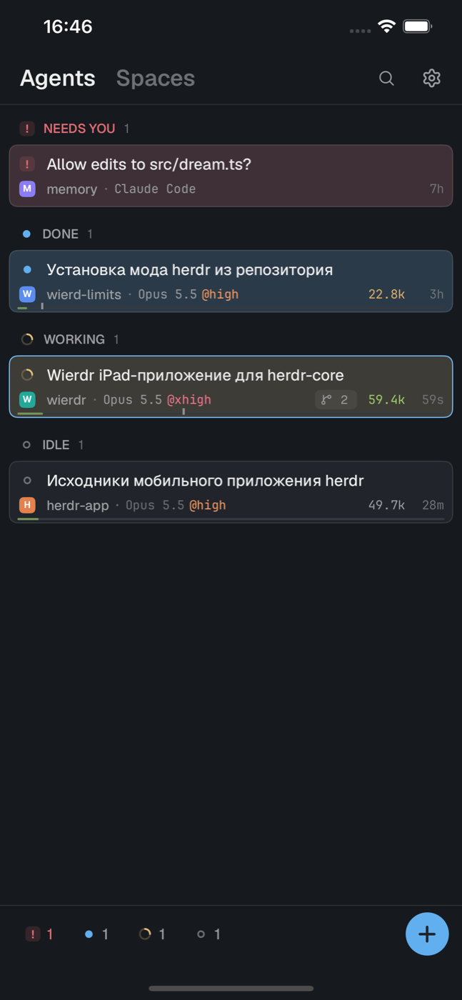

# Wierdr — что реализовано

Wierdr (`pw.xff.wierdr`) — нативное приложение для iPad и iPhone (SwiftUI + UIKit там, где нужен
терминал), которое подключается к **herdr-core** на Mac по SSH и показывает тот же мир,
что десктопный Herdr: спейсы, табы, сплиты, агентов и их живые терминалы. Внешний вид
сайдбара и терминальной панели перенесён с твоего сетапа (`wierd-layout`: `wierd-chrome`,
`wierd-agents`, `wierd-tabs`, `wierd-pane`, `agent-counts`) без панели лимитов.

Скриншоты: `docs/screenshots/` (`ipad-*` — демо‑режим, `live-*` — живое подключение к
твоему ядру из симулятора, `terminal-*` — терминал, `iphone-*` — iPhone, см. §7).

## 1. Подключение

- **Список хостов** (стартовый экран): добавить / изменить / удалить хост (адрес, порт, пользователь,
  способ входа). Хосты хранятся в `Application Support/hosts.json`, пароли и ключ — в Keychain.
- **SSH на нативном стеке Apple**: Network.framework (через SwiftNIO Transport Services) +
  SwiftNIO SSH + CryptoKit. На Mac выполняется `hc connect` (ищется в PATH, `~/.local/bin`,
  Homebrew, `~/.cargo/bin`, mise, nix — так же, как это делает сам herdr-core для `machine add`).
- **Вход по ключу**: ключ Ed25519 генерируется на iPad и хранится в Keychain (только это
  устройство). Публичный ключ показывается в редакторе хоста: Copy / Share.
- **Вход по паролю** (macOS sshd его поддерживает). После входа по паролю в Settings есть
  кнопка **«Install This iPad’s Key on …»**: приложение само добавит свой ключ в
  `~/.ssh/authorized_keys` на Mac и переключит хост на вход по ключу.
- **Проверка ключа хоста (TOFU)**: при первом подключении — алерт с отпечатком SHA256;
  при смене ключа — громкое предупреждение.
- **Переподключение**: при обрыве — автоматический реконнект с backoff; при возвращении
  приложения на передний план линия проверяется пингом и при необходимости поднимается заново.
  Баннер «Reconnecting…» в панели. Терминалы переаттачиваются сами (ядро присылает экран +
  2000 строк истории).
- **Демо‑режим** («Try the Demo»): тот же интерфейс на данных, повторяющих твой десктоп.

## 2. Сайдбар (как `wierd-chrome` + `wierd-agents`)

- **Brand bar**: логотип, «Wierdr», поиск (⌘P — быстрый переключатель спейсов/табов/агентов),
  кнопка скрытия сайдбара (⌘B).
- **Ширина**: край сайдбара тянется пальцем или курсором (240 pt … 640 pt, не больше 60%
  окна), и в док‑режиме, и в оверлее. У дока и оверлея своя ширина, обе
  запоминаются. Двойной тап по краю возвращает 300 pt.
- **Оверлей**: при скрытом сайдбаре свайп от левого края вытягивает его поверх панели
  (за пальцем). Закрывается свайпом влево (на строках свайп остаётся их действиями), тапом по
  затемнению, тапом по строке, кнопкой сайдбара или ⌘B.
- **Машины**: заголовки «This computer» и добавленных машин (`hc machine add`, например `lf`)
  появляются, когда есть удалённые машины; сворачиваются; «+» создаёт спейс на этой машине.
  Спейсы удалённых машин читаются из их собственных документов `herdr-app` через ядро Mac.
- **Карточки спейсов**: аватар с буквой и цветом **из твоего десктопа** (`shared.json` →
  `space.colors`), имя (своё или автоматическое — по git‑репозиторию/папке первого терминала,
  как в Herdr), git‑хвост (`repo · branch`, ↑ahead ↓behind), сводка статусов в свёрнутом виде,
  шеврон «скрыть/показать строки» (запоминается). Тап — выбрать спейс. Long‑press — меню:
  Rename, New Tab, Close Space.
- **Строки агентов** (52 pt): статус (working — кольцо‑спиннер, blocked — «!», done — синяя точка,
  idle — кольцо), заголовок (сессия pi из OSC 7501 `msg`), иконка провайдера/программы,
  модель (`Opus 5.5`), `@effort` с цветами твоей лестницы, бейдж сабагентов, размер контекста
  (`59.4k`, цвет по прогреву prompt‑кэша), возраст статуса (`56s`, `3h`), полоска контекста с
  тиком истечения кэша, подсветка фона по статусу, рамка фокуса. Данные — из меток `agent.*`,
  которые пишет pi (как в твоём моде), без лишних запросов.
- **Строки обычных терминалов** (28 pt): иконка программы, имя процесса, папка с `~` и
  сокращением посередине. Скобка, объединяющая панели одного сплит‑таба.
- **Сабагенты** (терминалы, запущенные агентом без своей панели) — раскрываются из бейджа.
- **Порядок** — как в `wierd-agents`: табы с агентами вперёд; внутри — закреплённые → по
  срочности (blocked > done > working > idle) → по свежести.
- Свайпы/контекстное меню строк: Pin/Unpin (`herdr.pinned`), Mark Unread (только idle, `herdr.seen=turn-1`) /
  Mark Idle (только done, `herdr.seen=turn`), Close Pane.
- **«Прочитано» синхронизировано с десктопом**: когда агент на экране iPad, Wierdr поднимает
  общую метку `herdr.seen` — «done» гаснет и на Mac, как между двумя окнами Herdr.
- Footer: **Settings** (тема: системная/светлая/тёмная, размер шрифта терминала, отключиться,
  установка ключа, лицензии).

## 3. Терминальная панель (как `wierd-tabs` + `wierd-pane` + `agent-counts`)

- **Таб‑бар** (42 pt): «пилюли» табов с иконкой программы первого агента, именем (или номером),
  статусом и крестиком у активного; горизонтальная прокрутка. Long‑press — Rename / New Tab / Close.
- **«+» меню**: Terminal (⌘T), «Start an agent» — список агентов из таблицы программ Herdr с
  проверкой, что они установлены на машине (Claude Code, Codex, Pi, Cursor…), New Space (⌘N).
  Агенты запускаются через интерактивный login‑shell, как это делает Herdr.
- **Панели**: дерево сплитов таба с весами из документа, карточки (радиус 10, рамка, акцентная
  рамка у сфокусированной), заголовок панели: иконка, имя программы, cwd; кнопки split right /
  split down / zoom / close (на сфокусированной панели всегда видны, на остальных — в меню).
  Zoom панели (⌘⇧↩).
- **Терминал**: SwiftTerm (Metal‑рендер), JetBrains Mono 14 + Symbols Nerd Font (твой
  pi‑статуслайн рисуется корректно), кириллица/CJK/эмодзи, truecolor, bold/italic, TUI
  (vim, btop, less, pi, Claude Code), прокрутка истории, выделение и копирование, вставка
  (bracketed paste), мышь в TUI через трекпад (средствами SwiftTerm).
  Протокол — как у десктопа: `history: 2000`, display‑facts (цвета/размер ячейки), RESIZE при
  изменении сетки, FOCUS, кредиты потока, ответы эмулятора как AUTOMATIC_INPUT, переаттач после
  `restarted` и обрыва, оверлей «Process exited (код)».
- **Клавиатура**: аппаратная (Magic Keyboard) со всеми модификаторами; Option = Alt;
  раскладка из твоего `keys.json`: ⌥←/⌥→ (слово), ⌥⌫, ⌘←/⌘→ (начало/конец строки), ⌘⌫,
  ⌘C/⌘V, ⌘. = Esc. Экранная клавиатура с панелью клавиш: esc, ctrl (липкий), alt, tab,
  `~ | / \ - _ : ; ` ' "`, стрелки.
- **Статус‑бар** (28 pt): счётчики blocked / done / working / idle; тап — перейти к следующему
  агенту с этим статусом.
- **Тосты** с ошибками команд.

## 4. Создание и изменение структуры (совместимо с десктопом)

Все команды повторяют семантику `herdr-app` (см. `docs/research/herdr-app-model.md` §4):
сначала запускается терминал с метками `herdr.space`/`herdr.tab`/`herdr.seen` и `keep: true`,
затем документ `herdr-app` в ядре правится compare‑and‑swap’ом с проверкой инвариантов
(при конфликте — перечитать и повторить намерение, а не старый документ). Неизвестные поля
сохраняются. Десктоп видит изменения в течение ~0.5 с.

- **New Space** (⌘N, «+» у машины, меню) — в папке сфокусированной панели (как в Herdr),
  в конце блока своей машины.
- **New Tab** (⌘T, «+») — shell или агент, сразу после активного таба.
- **Split Right / Down** (⌘D / ⌘⇧D) — с правилами весов Herdr (`Node::split`).
- **Close Pane / Tab / Space** (⌘⇧W / ⌘W / меню) — с подтверждением, если внутри работают
  агенты; терминалы и их сабагенты завершаются; последний таб закрывает спейс.
- **Rename Space / Tab** (меню; пустое имя = автоматическое).
- Если терминал завершился сам (`exit`), его панель убирается из документа (как делает
  десктоп), даже когда десктоп закрыт.

Проверено вживую на твоём ядре (из симулятора через SSH): создание спейса, переименование,
новый таб, split right + split down (три живых zsh с твоим powerline‑промптом), закрытие
спейса — десктоп показал и затем убрал спейс (он ушёл в `recent`), все терминалы завершились.

## 5. Горячие клавиши (аппаратная клавиатура)

| Клавиши | Действие |
|---|---|
| ⌘T / ⌘N | новый таб / новый спейс |
| ⌘W / ⌘⇧W | закрыть таб / панель |
| ⌘D / ⌘⇧D | сплит вправо / вниз |
| ⌘⇧↩ | zoom панели |
| ⌘⌥ ←↑→↓ | фокус соседней панели |
| ⌘] / ⌘[ | следующий / предыдущий агент (строка сайдбара) |
| ⌘⇧] / ⌘⇧[, ⌃Tab / ⌃⇧Tab | следующий / предыдущий таб |
| ⌘⌥] / ⌘⌥[ | следующий / предыдущий спейс |
| ⌘1…⌘9 / ⌃1…⌃9 | таб N / спейс N |
| ⌘B | показать/скрыть сайдбар |
| ⌘P | быстрый переключатель |
| ⌘, | настройки |

Удерживая ⌘, iPadOS показывает все команды (меню Space / Pane / Go).

## 6. Архитектура (кратко)

`Packages/WierdrKit` — всё, кроме UI (общее для iPad и iPhone):
`HerdrCore` (протокол herdr-core: фреймы, JSON‑RPC, attach‑стримы, события, документы),
`HerdrSSH` (SSH‑транспорт, ключи, known hosts), `WierdrModel` (живая модель + команды,
`WorkspaceEngine`), `wierdr-cli` (отладка на Mac: `wierdr-cli ws`, `ls`, `doc`, `events`, `attach`).
`App/Sources` — SwiftUI. Подробно: `docs/architecture.md`, `docs/hc-protocol-client.md`,
`docs/ssh.md`. Тесты: `make test` (unit), `WIERDR_LIVE=1` / `WIERDR_SSH_LIVE=1` — живые.

## 7. iPhone

Та же сборка (`TARGETED_DEVICE_FAMILY 1,2`), тот же `WierdrKit` и те же команды; на iPhone
(в любой ориентации) и в узком окне iPad вместо сайдбара рядом с панелью — **список и одна
панель на весь экран** (`App/Sources/Phone/`). Широкий iPad не изменился.

- **Список, режим Agents** (по умолчанию): все агенты всех спейсов и машин, сгруппированы
  по тому, что им нужно от тебя — **Needs you → Done → Working → Idle**; внутри группы
  закреплённые, потом самые свежие. Строка — та же, что в сайдбаре (статус, заголовок,
  модель, `@effort`, контекст, возраст, сабагенты, полоска контекста), плюс аватар и имя
  спейса. Свайпы и long‑press: Pin, Unread/Idle, Close.
- **Режим Spaces**: карточки спейсов как в сайдбаре (машины, git, сворачивание, меню спейса;
  в меню New Tab — терминал или любой установленный агент). Режим запоминается.
- Внизу списка: счётчики статусов (тап — следующий агент с этим статусом) и **+** — новый
  спейс с терминалом или агентом (в папке последней открытой панели, как New Space на десктопе).
  Сверху: поиск (быстрый переключатель) и настройки.
- **Экран панели** (тап по строке): одна панель на весь экран, без рамок, терминал от края
  до края (отступы 8 × 6 pt), шрифт 12 pt (~57 колонок в портрете).
  - Верхняя панель: назад, аватар спейса, заголовок агента со статусом, под ним
    «спейс · модель @effort · контекст» (у терминала — папка), меню **⋯**: Pin, Unread/Idle,
    New Tab (терминал/агент), Split, Rename Tab/Space, размер текста, Settings, Close Pane/Tab.
  - **Пилюля «! 2 ›» / «● 3 ›»** справа: сколько других агентов ждут тебя (needs you, иначе
    done); тап — следующий такой агент, по всем спейсам. Цикл «ответил → следующий» без возврата
    в список.
  - Под ней, если в спейсе больше одной панели, — **полоса панелей спейса** (все табы, в порядке
    табов): статус/иконка и имя, тап — переключиться.
  - **Назад**: кнопка или свайп от левого края (экран едет за пальцем, как в системной навигации).
    Если панель закрылась (здесь, на десктопе, или процесс завершился) — возврат в список.
- **Ввод** под терминалом, пока у терминала нет клавиатуры:
  - **Быстрые клавиши** (строка прокручивается): esc, ⏎, ↑ ↓ ← → (повтор при удержании),
    tab, ⇧tab, 1 2 3, y n, / @ !, ^C ^L ^R — ответить агенту (выбрать вариант, подтвердить,
    прервать) без клавиатуры.
  - **Compose**: системное поле ввода (диктовка, автокоррекция, любой язык, до 6 строк).
    Кнопка ↑ отправляет текст в программу одной вставкой (bracketed paste, если программа
    его включила — переводы строк остаются в сообщении) и затем Return. Пустое поле — кнопка
    ⏎ (просто Return). Long‑press: «Insert Without Return», «Paste Here», «Clear».
    Для агентов — заглавные и автокоррекция, для шелла — ввод как есть; «умные» кавычки
    и тире клавиатуры возвращаются в `"` `'` `--`. Черновик живёт у каждого терминала свой.
  - **⌨** — печатать прямо в терминал (системная клавиатура + клавиш‑бар терминала: esc, ctrl,
    alt, tab, символы, стрелки, скрыть). Тап по терминалу делает то же самое.
- **Размер текста**: щипок двумя пальцами по терминалу (9…24 pt, бейдж с размером; терминалы
  переаттачиваются в новый размер), или − / + в меню ⋯, или Settings.
- **Баннер** сверху, пока ты в панели: другой агент начал ждать тебя или закончил — аватар,
  статус, заголовок; тап — перейти, свайп вверх — убрать; лёгкая вибрация.
- Экран не гаснет, пока на нём работающий агент (заблокированный iPhone рвёт соединение).
- Альбомная ориентация: то же самое, полоса панелей скрыта ради высоты.
- «Прочитано» (`herdr.seen`) — только для панели на экране; в списке ничего не отмечается.
- Тексты «This iPhone's key», «Install This iPhone's Key on …» и т. п. называют устройство.

Ещё: `iphone-compose-live.png` (compose с клавиатурой, живой zsh), `iphone-pi-live.png` (pi на
ширине телефона), `iphone-banner-dark.png`, `iphone-spaces-light.png`, `iphone-landscape-dark.png`.
