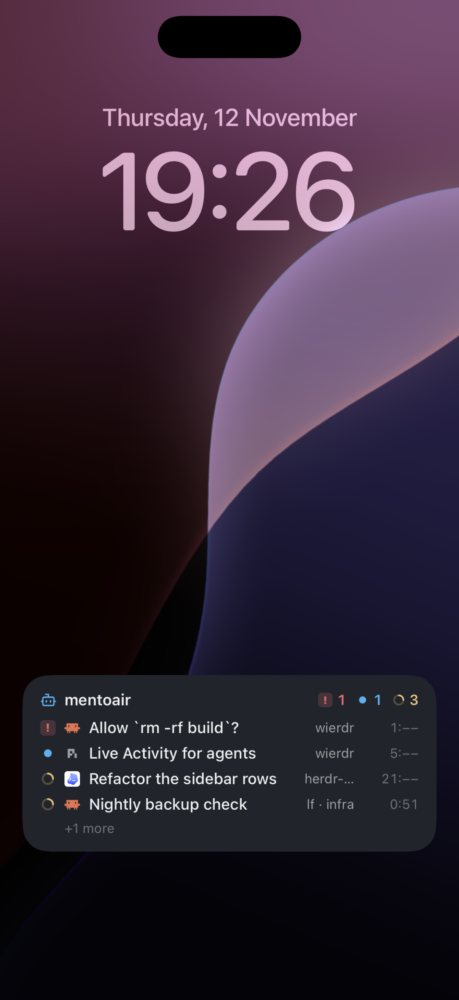

# Wierdr — что реализовано

Wierdr (`pw.xff.wierdr`) — нативное приложение для iPad и iPhone (SwiftUI + UIKit там, где нужен
терминал), которое подключается к **herdr-core** на Mac по SSH и показывает тот же мир,
что десктопный Herdr: спейсы, табы, сплиты, агентов и их живые терминалы. Внешний вид
сайдбара и терминальной панели перенесён с твоего сетапа (`wierd-layout`: `wierd-chrome`,
`wierd-agents`, `wierd-tabs`, `wierd-pane`, `agent-counts`) без панели лимитов.

Скриншоты: `docs/screenshots/` (`ipad-*` — демо‑режим, `live-*` — живое подключение к
твоему ядру из симулятора, `terminal-*` — терминал, `iphone-*` — iPhone, см. §7).

## 1. Подключение

- **Список хостов** (стартовый экран): добавить / изменить / удалить хост (адрес, порт, пользователь,
  способ входа). Хосты хранятся в `Application Support/hosts.json`, пароли и ключ — в Keychain.
- **SSH на нативном стеке Apple**: Network.framework (через SwiftNIO Transport Services) +
  SwiftNIO SSH + CryptoKit. На Mac выполняется `hc connect` (ищется в PATH, `~/.local/bin`,
  Homebrew, `~/.cargo/bin`, mise, nix — так же, как это делает сам herdr-core для `machine add`).
- **Вход по ключу**: ключ Ed25519 генерируется на iPad и хранится в Keychain (только это
  устройство). Публичный ключ показывается в редакторе хоста: Copy / Share.
- **Вход по паролю** (macOS sshd его поддерживает). После входа по паролю в Settings есть
  кнопка **«Install This iPad’s Key on …»**: приложение само добавит свой ключ в
  `~/.ssh/authorized_keys` на Mac и переключит хост на вход по ключу.
- **Проверка ключа хоста (TOFU)**: при первом подключении — алерт с отпечатком SHA256;
  при смене ключа — громкое предупреждение.
- **Переподключение**: при обрыве — автоматический реконнект с backoff; при возвращении
  приложения на передний план линия проверяется пингом и при необходимости поднимается заново.
  Баннер «Reconnecting…» в панели. Терминалы переаттачиваются сами (ядро присылает экран +
  2000 строк истории).
- **Демо‑режим** («Try the Demo»): тот же интерфейс на данных, повторяющих твой десктоп.

## 2. Сайдбар (как `wierd-chrome` + `wierd-agents`)

- **Brand bar**: логотип, «Wierdr», поиск (⌘P — быстрый переключатель спейсов/табов/агентов),
  кнопка скрытия сайдбара (⌘B).
- **Ширина**: край сайдбара тянется пальцем или курсором (240 pt … 640 pt, не больше 60%
  окна), и в док‑режиме, и в оверлее. У дока и оверлея своя ширина, обе
  запоминаются. Двойной тап по краю возвращает 300 pt.
- **Оверлей**: при скрытом сайдбаре свайп вправо по терминалу (в любом месте; если открыта
  колонка клавиш — сначала закрывает её) или от левого края вытягивает его поверх панели
  (за пальцем). Закрывается свайпом влево (где угодно, по строкам тоже), тапом по
  затемнению, тапом по строке, кнопкой сайдбара или ⌘B. При пристыкованном сайдбаре свайп
  вправо по терминалу ничего не делает.
- **Машины**: заголовки «This computer» и добавленных машин (`hc machine add`, например `lf`)
  появляются, когда есть удалённые машины; сворачиваются; «+» создаёт спейс на этой машине.
  Спейсы удалённых машин читаются из их собственных документов `herdr-app` через ядро Mac.
- **Карточки спейсов**: аватар с буквой и цветом **из твоего десктопа** (`shared.json` →
  `space.colors`), имя (своё или автоматическое — по git‑репозиторию/папке первого терминала,
  как в Herdr), git‑хвост (`repo · branch`, ↑ahead ↓behind), сводка статусов в свёрнутом виде,
  шеврон «скрыть/показать строки» (запоминается). Тап — выбрать спейс. Long‑press — меню:
  Rename, New Tab, Close Space.
- **Перетаскивание спейсов**, как в `wierd-agents`: карточку берут за заголовок (пальцем —
  удержать и повести, как везде в iOS: меню спейса уходит, карточка поднимается; указателем —
  нажать и тянуть, меню — правым кликом) — она поднимается целиком, со строками (тень,
  акцентная рамка) и летит за пальцем, держась там, где её взяли, — и над панелью тоже, а
  карточки её машины расступаются там, куда она ляжет: на её месте пунктирный слот `accent`
  в её высоту. Отпустил над списком — карточка за 0,22 с въезжает в слот, на лету становясь
  обычной (рамка и тень гаснут), спейс переезжает (`space.move`: правка документа своей
  машины, десктоп видит новый порядок). Пока палец за пределами списка, слот стоит на её
  прежнем месте; отпустил там — карточка прилетает обратно в него. Только среди спейсов своей
  машины; у краёв список прокручивается сам. На iPhone в режиме Spaces — так же.
- **Строки агентов** (52 pt): статус (working — кольцо‑спиннер, blocked — красная точка, done — зелёная точка,
  idle — кольцо), заголовок (сессия pi из OSC 7501 `msg`), иконка провайдера/программы,
  модель (`Opus 5.5`), `@effort` с цветами твоей лестницы, бейдж сабагентов, размер контекста
  (`59.4k`, цвет по прогреву prompt‑кэша), возраст статуса (`56s`, `3h`), полоска контекста с
  тиком истечения кэша, подсветка фона по статусу, рамка фокуса. Данные — из меток `agent.*`,
  которые пишет pi (как в твоём моде), без лишних запросов.
- **Строки обычных терминалов** (28 pt): иконка программы, имя процесса, папка с `~` и
  сокращением посередине. Скобка, объединяющая панели одного сплит‑таба.
- **Сабагенты** (терминалы, запущенные агентом через `hc run`), как в `wierd-agents`: деревом
  под строкой агента, в глубину (сабагенты сабагентов — уровнем ниже), соединены линиями
  `├ └ │`. Сабагент — две строки, как у агента: статус (никогда не «done» — он отчитывается
  родителю; error — красная точка) и чем занят (`msg`, иначе говорящий заголовок, иначе имя `--name`),
  под ним модель, `@effort`, контекст и возраст статуса. Обычный терминал — одна строка: иконка
  и имя. Раскрыты по умолчанию; бейджи в строке агента (бот — сабагенты + `agent.subagents`
  pi, `>_` — терминалы) сворачивают и разворачивают дерево (строки списка вставляются и
  уходят с анимацией). Агент сортируется по самому срочному из себя и своих сабагентов
  (сабагент ждёт тебя — родитель поднимается наверх таба); сводка свёрнутой карточки и
  машины считает сабагентов в спейсе родителя. Оставленный (Keep) сабагент — всё ещё под
  родителем, не строкой своего таба; тап — его панель.
- **Тап по сабагенту без панели**: на iPad — окно поверх всего (82%, как peek десктопа):
  полоса со статусом, заголовком, «from <родитель>», **Keep ↵** и **✕ esc**, под ней живой
  терминал (клавиатура — двойным тапом или кликом указателем). Пока окно открыто, колонка
  клавиш (свайп влево по его терминалу), клавиатура и поле сообщения — для сабагента
  (колонка выезжает у края панели, как всегда). Окно открылось или закрылось —
  колонка убирается, чтобы клавиши не ушли не тому.
  Тап мимо окна, ✕ или esc закрывают его, сабагент продолжает работать; esc и ↵ — кнопок
  окна, пока клавиатура не у терминала. **Keep** делает его табом сразу за табом родителя
  (за уже оставленными сабагентами того же родителя): метки `herdr.space`/`herdr.tab`,
  `terminal.keep`, правка документа — десктоп видит таб и тоже держит строку под родителем.
  Long‑press по строке — Show / Keep as Tab.
- **Порядок** — как в `wierd-agents`: табы с агентами вперёд; внутри — закреплённые → по
  срочности (blocked > done > working > idle) → по свежести.
- Контекстное меню строк (long‑press): Pin/Unpin (`herdr.pinned`), Mark Unread (только idle,
  `herdr.seen=turn-1`) / Mark Idle (только done, `herdr.seen=turn`), Close Pane. Свайп вправо —
  Pin/Unpin; свайпа влево у строк нет (он закрывает оверлей и список на iPhone).
- **«Прочитано» синхронизировано с десктопом**: когда агент на экране iPad, Wierdr поднимает
  общую метку `herdr.seen` — «done» гаснет и на Mac, как между двумя окнами Herdr.
- **Лимиты подписок** над футером — как сайдбар мода `limits` на десктопе: по строке на аккаунт
  (иконка Claude/Codex, имя, план), под ней все его окна — подпись, полоска (заливка — доля, тик —
  сколько времени окна прошло, перерасход за тиком толще), процент цветом по темпу (зелёный /
  жёлтый с `›` / красный с `››` или от 90%), время до сброса. Тап по аккаунту сворачивает его
  (анимированно, вместе со списком выше) до одного «главного» окна — закреплённого, иначе того,
  что кончится раньше; оно показано в строке аккаунта так же, как в развёрнутом виде (полоска с
  тиком, процент, время до сброса — в тех же колонках). Тап по окну закрепляет его. Оба
  запоминаются. В узком сайдбаре (< 276 pt) полоски уходят под цифры, а если в строке аккаунта
  не хватает места, первым пропадает время до сброса (как в моде).
  Данные — документ `limits` в herdr-core, который пишет `@wierdbytes/pi-herdr` (≥ 0.4.0) при
  каждом ответе Claude/Codex; читается со всех подключённых машин, один аккаунт сливается.
  `7 days + extra` (`7d_oi`) не показывается, как на десктопе. Нет данных — нет панели.
- Footer: **Settings** (тема: системная/светлая/тёмная, размер шрифта терминала, отключиться,
  установка ключа, лицензии).

## 3. Терминальная панель (как `wierd-tabs` + `wierd-pane` + `agent-counts`)

- **Таб‑бар** (42 pt): «пилюли» табов с иконкой программы первого агента, именем (или номером),
  статусом и крестиком у активного; горизонтальная прокрутка. Long‑press — Rename / New Tab / Close.
- **«+» меню**: Terminal (⌘T), «Start an agent» — список агентов из таблицы программ Herdr с
  проверкой, что они установлены на машине (Claude Code, Codex, Pi, Cursor…), New Space (⌘N).
  Агенты запускаются через интерактивный login‑shell, как это делает Herdr.
- **Панели**: дерево сплитов таба с весами из документа, карточки (радиус 10, рамка, акцентная
  рамка у сфокусированной), заголовок панели: иконка, имя программы, cwd; кнопки split right /
  split down / zoom / close (на сфокусированной панели всегда видны, на остальных — в меню).
  Zoom панели (⌘⇧↩).
- **Терминал**: SwiftTerm (Metal‑рендер), JetBrains Mono 14 + Symbols Nerd Font (твой
  pi‑статуслайн рисуется корректно), кириллица/CJK/эмодзи, truecolor, bold/italic, TUI
  (vim, btop, less, pi, Claude Code), прокрутка истории, выделение и копирование, вставка
  (bracketed paste), мышь в TUI через трекпад (средствами SwiftTerm).
  Протокол — как у десктопа: `history: 2000`, display‑facts (цвета/размер ячейки), RESIZE при
  изменении сетки, FOCUS, кредиты потока, ответы эмулятора как AUTOMATIC_INPUT, переаттач после
  `restarted` и обрыва, оверлей «Process exited (код)».
- **Клавиатура**: аппаратная (Magic Keyboard) со всеми модификаторами; Option = Alt;
  раскладка из твоего `keys.json`: ⌥←/⌥→ (слово), ⌥⌫, ⌘←/⌘→ (начало/конец строки), ⌘⌫,
  ⌘C/⌘V, ⌘. = Esc. Экранная клавиатура с панелью клавиш: esc, ctrl (липкий), alt, tab,
  `~ | / \ - _ : ; ` ' "`, стрелки.
  Сайдбар и панель кончаются над панелью клавиш (или над полем сообщения): над
  пристыкованной клавиатурой, у нижнего края при плавающей или аппаратной.
- **Поле сообщения — всегда под панелями** (одно на все панели таба, на месте бывшего
  статус‑бара; как на iPhone, §7): кнопка‑скрепка и поле «Message to Pi» — кому уйдёт (панели в
  фокусе), края выровнены с карточками панелей. Тап по полю — клавиатура, поле над ней (у нижнего
  края при плавающей); двойной тап по терминалу — клавиатура уходит, поле сужается до двух
  строк. Пока клавиатура у самого терминала (двойной тап, клик указателем), поля нет. Другая
  панель в фокусе — клавиатура поля уходит, в поле черновик той панели. У окна сабагента — своё
  поле внизу окна.
- **Ввод пальцами — свайп влево по терминалу** (как панель клавиш на iPhone, §7). **Свайп
  влево** в любом месте терминала (по панели в сплите — она получает фокус) вытягивает колонку
  крупных клавиш iPhone (Paste, ^R ^L ^D ^J ^C, ! @ /, n y 3 2 1, ⇧tab tab, ← → ↑ ↓, esc, ⏎;
  при открытой клавиатуре сверху ещё Hide) у правого края за пальцем; она открывается с ⏎ на
  высоте, где начался свайп, — под большим пальцем. Клавиши идут в панель в фокусе.
  VoiceOver: действие «Keys» у терминала.
  - Закрыть колонку — только свайпом вправо (по колонке или терминалу). Тапы рядом с ней —
    клики в программу; двойной тап рядом — клавиатура терминала или убрать её (колонка
    остаётся).
  - **Тап пальцем по терминалу** — клик в программу, и при открытой клавиатуре тоже: она
    остаётся (прокрутка тоже идёт в терминал). **Двойной тап** — клавиатура терминала, при
    открытой клавиатуре (терминала или поля) — убрать её (как на iPhone, §7): в программу
    ничего не уходит, слово не выделяется.
    **Клик указателем** (трекпад, мышь, Universal Control) — как на Mac: даёт терминалу ввод и
    клавиатуру не прячет; двойной/тройной клик выделяет слово/строку.
  - Клавиатура переходит за фокусом: если она была у терминала, другая панель в фокусе
    получает её сама.
  - Пока открыт оверлей сайдбара, колонки нет.
- Статус‑бара со счётчиками агентов больше нет (его место — у поля сообщения): статусы видны
  в строках сайдбара, к следующему агенту — ⌘] / ⌘[.
- **Тосты** с ошибками команд.

## 4. Создание и изменение структуры (совместимо с десктопом)

Все команды повторяют семантику `herdr-app` (см. `docs/research/herdr-app-model.md` §4):
сначала запускается терминал с метками `herdr.space`/`herdr.tab`/`herdr.seen` и `keep: true`,
затем документ `herdr-app` в ядре правится compare‑and‑swap’ом с проверкой инвариантов
(при конфликте — перечитать и повторить намерение, а не старый документ). Неизвестные поля
сохраняются. Десктоп видит изменения в течение ~0.5 с.

- **New Space** (⌘N, «+» у машины, меню) — в папке сфокусированной панели (как в Herdr),
  в конце блока своей машины.
- **New Tab** (⌘T, «+») — shell или агент, сразу после активного таба.
- **Split Right / Down** (⌘D / ⌘⇧D) — с правилами весов Herdr (`Node::split`).
- **Close Pane / Tab / Space** (⌘⇧W / ⌘W / меню) — с подтверждением, если внутри работают
  агенты; терминалы и их сабагенты завершаются; последний таб закрывает спейс.
- **Rename Space / Tab** (меню; пустое имя = автоматическое).
- Если терминал завершился сам (`exit`), его панель убирается из документа (как делает
  десктоп), даже когда десктоп закрыт.

Проверено вживую на твоём ядре (из симулятора через SSH): создание спейса, переименование,
новый таб, split right + split down (три живых zsh с твоим powerline‑промптом), закрытие
спейса — десктоп показал и затем убрал спейс (он ушёл в `recent`), все терминалы завершились.

## 5. Горячие клавиши (аппаратная клавиатура)

| Клавиши | Действие |
|---|---|
| ⌘T / ⌘N | новый таб / новый спейс |
| ⌘W / ⌘⇧W | закрыть таб / панель |
| ⌘D / ⌘⇧D | сплит вправо / вниз |
| ⌘⇧↩ | zoom панели |
| ⌘⌥ ←↑→↓ | фокус соседней панели |
| ⌘] / ⌘[ | следующий / предыдущий агент (строка сайдбара) |
| ⌘⇧] / ⌘⇧[, ⌃Tab / ⌃⇧Tab | следующий / предыдущий таб |
| ⌘⌥] / ⌘⌥[ | следующий / предыдущий спейс |
| ⌘1…⌘9 / ⌃1…⌃9 | таб N / спейс N |
| ⌘B | показать/скрыть сайдбар |
| ⌘P | быстрый переключатель |
| ⌘, | настройки |

Удерживая ⌘, iPadOS показывает все команды (меню Space / Pane / Go).

## 6. Архитектура (кратко)

`Packages/WierdrKit` — всё, кроме UI (общее для iPad и iPhone):
`HerdrCore` (протокол herdr-core: фреймы, JSON‑RPC, attach‑стримы, события, документы),
`HerdrSSH` (SSH‑транспорт, ключи, known hosts), `WierdrModel` (живая модель + команды,
`WorkspaceEngine`), `wierdr-cli` (отладка на Mac: `wierdr-cli ws`, `ls`, `doc`, `events`, `attach`),
`WierdrActivity` / `WierdrPush` / `wierdr-push` (Live Activity агентов, §7).
`App/Sources` — SwiftUI. Подробно: `docs/architecture.md`, `docs/hc-protocol-client.md`,
`docs/ssh.md`. Тесты: `make test` (unit), `WIERDR_LIVE=1` / `WIERDR_SSH_LIVE=1` — живые.

## 7. iPhone

Та же сборка (`TARGETED_DEVICE_FAMILY 1,2`), тот же `WierdrKit` и те же команды; на iPhone
(в любой ориентации) и в узком окне iPad вместо сайдбара рядом с панелью — **одна панель на
весь экран и список, выезжающий поверх неё** (`App/Sources/Phone/`). Широкий iPad остался со сплитами; панель клавиш и поле сообщения там те же, свайпом влево по терминалу (§3).

- **Список поверх панели**, как оверлей сайдбара на iPad: свайп вправо по терминалу (в любом
  месте; если открыта панель клавиш — сначала закрывает её) или от левого края (список едет за
  пальцем), или кнопка сайдбара в верхней панели. Он на всю ширину экрана; свайп влево (где
  угодно, по строкам тоже) или тап по строке убирает его. Ширина не настраивается.
  При запуске список открыт поверх последней панели. Пока он открыт, панель клавиш и
  клавиатуры убраны, свайп влево по терминалу её не вытягивает.

- **Список, режим Agents** (по умолчанию): все агенты всех спейсов и машин, сгруппированы
  по тому, что им нужно от тебя — **Needs you → Done → Working → Idle**; внутри группы
  закреплённые, потом самые свежие. Строка — та же, что в сайдбаре (статус, заголовок,
  модель, `@effort`, контекст, возраст, сабагенты, полоска контекста), плюс аватар и имя
  спейса; её сабагенты — деревом в той же карточке, а группа — по самому срочному из агента
  и его сабагентов (сабагент ждёт тебя — агент в «Needs you»). Свайп вправо — Pin;
  long‑press — Pin, Unread/Idle, Close.
- **Тап по сабагенту** показывает его на весь экран, как панель агента, на месте родителя:
  капсула — в обводке цвета его статуса (как в списке), заголовок — чем занят; в меню (тап по капсуле) — **Keep as Tab**
  и **Back to <родитель>**. Клавиши, клавиатура и поле сообщения — его; рамка фокуса в списке — на его
  строке, не на родителе.
- **Режим Spaces**: карточки спейсов как в сайдбаре (машины, git, сворачивание, меню спейса;
  в меню New Tab — терминал или любой установленный агент). Режим запоминается.
- Над подвалом — **лимиты подписок**, как в сайдбаре iPad (крупнее).
- Внизу списка: счётчики статусов (тап — следующий агент с этим статусом) и **+** — новый
  спейс с терминалом или агентом (в папке последней открытой панели, как New Space на десктопе).
  Сверху: поиск (быстрый переключатель) и настройки.
- **Экран панели** (тап по строке): одна панель на весь экран, без рамок, терминал от края
  до края (отступы 8 × 6 pt), шрифт 12 pt (~57 колонок в портрете).
  - Верхняя панель — как шапка чата Telegram: две стеклянные пилюли высотой 44 pt на фоне
    терминала, без линии и своего цвета, на одной линии; стекло и отступы от краёв — как у
    поля сообщения (26 pt у скруглённых углов экрана).
  - Слева **кнопка списка** — стеклянный круг со значком списка. Пока среди других агентов
    (кроме того, что на экране) есть не idle — она как кнопка «назад» Telegram: **«‹»** и
    круглый бейдж с числом агентов с самым срочным статусом (needs you, затем done, затем
    working), залитый цветом этого статуса; круг растягивается в капсулу. Тап — список.
  - Дальше стеклянная **капсула заголовка**, текст по центру, как у Telegram: первая строка —
    заголовок агента или имя программы (15 pt, полужирный, длинный обрезается «…»), вторая —
    спейс (12 pt, серый). Значка статуса нет: капсулу обводит линия цвета статуса агента
    (1.5 pt, как кайма Live Activity вокруг Dynamic Island; needs you, done, working), стекло
    под ней обычное; у idle и терминалов линии нет. Модели, effort и контекста здесь
    нет (они — в строках списка).
    **Тап по капсуле** — меню панели. Капсула на это время вырастает влево на всю ширину
    (кнопка списка уезжает влево), а если заголовок не уместился в строку — и вниз поверх
    терминала (терминал не меняет размер): до 4 строк заголовка и строка спейса. Когда меню
    уходит, капсула сжимается обратно и кнопка возвращается; всё анимировано. Меню выезжает
    вниз из-под капсулы (по центру, без сдвига вбок) и не закрывает её; оно в
    том же стекле, плотнее, чтобы терминал не просвечивал; строки как у системного меню.
    Pin, Unread/Idle; New Tab (терминал или установленный агент) и Split (вправо/вниз)
    раскрываются на месте; размер текста (− / + меню не закрывают — можно нажать несколько раз
    подряд); Close Pane/Tab. Тап мимо меню (или снова по капсуле) закрывает его и в терминал не
    уходит. Settings — шестерёнка списка, Rename Space — меню спейса в режиме Spaces;
    переименовать таб на iPhone нельзя. Меню своё, не системное: системное на iOS 26+ вырастает
    из своей кнопки и прячет её.
  - Полосы панелей спейса нет: другие панели — в списке.
  - Если панель закрылась (здесь, на десктопе, или процесс завершился) — выезжает список.
- **Ввод**: под терминалом всегда **поле сообщения** (по образцу Telegram, см. ниже); его нет,
  только пока клавиатура у самого терминала.
  - **Поле сообщения** — как композер Telegram для iOS (его геометрия, стекло и анимации; цвета
    — из темы Wierdr): слева кнопка‑скрепка (стеклянный круг 40 pt), справа от неё поле (стеклянная
    капсула высотой 40 pt, радиус 20; на iOS 26+ — Liquid Glass, раньше — его рисованная замена),
    системный шрифт 17 pt, плейсхолдер «Message». Без клавиатуры панель отступает от краёв экрана
    (как у Telegram: 26 pt по бокам, 28 pt от низа — у скруглённых углов), с клавиатурой — 8 pt
    по бокам и над клавиатурой; переход — пружиной клавиатуры. Справа от поля кнопок пока нет
    (место под голосовой режим).
  - **Тап по полю** — клавиатура (системное поле: диктовка, автокоррекция, любой язык; курсор —
    куда тапнул). Поле растёт вверх с каждой строкой (0,1 с), до предела Telegram (место над
    ним минус 120 pt, не больше 12 строк), дальше прокручивается. **Двойной тап по терминалу** —
    клавиатура уходит мгновенно, поле сужается до двух строк (короткий черновик — до одной) —
    окна в черновик как он есть (с переводами строк), каждый раз с первой строки; пальцем его
    можно прокрутить по строкам (останавливается на целой строке);
    тап — клавиатура, курсор там, куда тапнул, поле снова во весь текст.
  - **Кнопка отправки** — внутри поля справа внизу, акцентная капсула с бумажным самолётиком
    Telegram; появляется с первым символом и уходит с последним, как у Telegram: из точки у края
    поля (масштаб 0,001 → 1, сдвиг 17 pt), из размытия 4 pt, проявляясь за 0,2 с, самолётик
    влетает снизу слева; кривая 0,4 с (0.38, 0.7, 0.125, 1). Нажатие — кнопка проседает до 0,75.
    Отправка: текст уходит в программу одной вставкой (bracketed paste, если программа его
    включила — переводы строк остаются в сообщении) и затем Return; поле очищается, клавиатура
    уходит (смотреть ответ). Long‑press: «Insert Without Return», «Clear». Return с аппаратной
    клавиатуры отправляет (⇧Return — новая строка; в пустом поле — просто Return в программу),
    Return экранной — новая строка. Для агентов — заглавные и автокоррекция, для шелла — ввод
    как есть; «умные» кавычки клавиатура не ставит, тире — только в тексте для агента;
    оставшиеся «умные» кавычки и тире у флагов при отправке становятся `"` `'` `--`. Текст —
    черновик этого терминала (другая панель — свой черновик).
  - **Скрепка** — меню: **Photo Library** (системный выбор фото, без доступа ко всей
    библиотеке), **File** (любой файл из «Файлов», до 8 МБ), **Paste Image** (картинка из
    буфера). Wierdr кладёт файл рядом с терминалом на его машине (`terminal.put`, как Ctrl+V
    картинки на десктопе: `~/.local/state/herdr-core/…/files/<терминал>/`, удаляется вместе с
    терминалом) и дописывает его путь в поле (с пробелом после) — остаётся дописать, что с ним
    сделать; если выбор забрал клавиатуру у поля, она возвращается. Скриншоты остаются PNG, фото
    (HEIC и др.) становятся JPEG, всё больше 2048 px уменьшается; файлы — как есть. Пока файл
    грузится, на месте скрепки — индикатор.
  - **Клавиатура терминала — двойным тапом по терминалу** (на iPad так же): печатать прямо в
    терминал, системная клавиатура и над ней клавиш‑бар терминала — esc, ctrl, alt, tab,
    символы, скрыть (стрелок в нём на iPhone нет, они в панели клавиш, на iPad остались). Поле
    сообщения на это время скрыто. Двойной тап — не клик: в программу ничего не уходит, слово
    не выделяется (выделение — в меню долгого тапа). VoiceOver: действие «Terminal Keyboard» у
    терминала.
  - **Тапы по терминалу** — клики в программу (pi, vim с мышью; ссылки открываются), прокрутка
    — прокрутка; клавиатуру они не открывают и открытую (терминала или поля) не убирают. Убрать
    клавиатуру — **двойным тапом по терминалу**, мгновенно, без анимации (рядом с открытой
    панелью клавиш тоже; панель остаётся). Пока клавиатура открыта, клик уходит в программу
    чуть позже — после того как ясно, что второго тапа не будет.
  - **Панель клавиш** у правого края — ответить агенту (выбрать вариант, подтвердить,
    прервать) без клавиатуры или вместе с ней (тогда панель — над клавиатурой, клавиши её не
    убирают). Свайп влево в любом месте терминала (в основном
    горизонтальный: вертикальный — прокрутка терминала; не во время перетаскивания выделения)
    вытягивает её за пальцем (VoiceOver: действие «Keys» у терминала). Ни язычка у правого
    края, ни отдельного свайпа от края нет. Узкая колонка 96 pt без подложки; клавиши — пилюли в
    стекле поля сообщения и верхней панели (Liquid Glass на iOS 26+, до него — его нарисованная
    замена), 52 pt высотой, во всю ширину колонки, системный шрифт и цвет темы; ⏎ — акцентная
    пилюля внутри стекла, как кнопка отправки. Нажатие гасит значок, как у скрепки (⏎ чуть
    проседает). Между клавишами виден терминал. Колонка
    прокручивается и каждый раз открывается с ⏎ (внизу колонки, где самые частые клавиши) на
    той высоте, где начался свайп, — под большим пальцем (с открытой клавиатурой — внизу
    колонки). Прокрутка за край возвращает колонку туда, где крайняя клавиша видна целиком, а
    следующая — наполовину: вверх — ⏎ у верха колонки и половина esc над ним, вниз — первая
    клавиша у низа колонки и половина следующей под ней (с клавиатурой Hide и Paste, без неё
    Paste и ^R); отпущенная за краем — на ходу или после остановки — за ~0,3 с одним плавным
    движением. Когда места становится меньше (появилась клавиатура, выросло поле сообщения),
    колонка сдвигается, только если иначе нарушились бы эти правила, — с анимацией, ровно до
    ближайшего допустимого положения; когда места становится больше (клавиатура ушла, поле
    сжалось), колонка стоит на месте.
    Сверху вниз: при открытой клавиатуре **Hide** — убрать её (без клавиатуры на её месте
    пусто, поэтому, когда она появляется, ничего не сдвигается); **Paste** (текст из буфера: в
    сообщение, пока у поля клавиатура, иначе в программу вставкой, без Return); ^R ^L ^D
    ^J ^C; ! @ /; n y 3 2 1; ⇧tab tab; ← → ↑ ↓ (повтор при удержании);
    esc, ⏎ (акцентная). Клавиши идут прямо в программу, даже пока пишется сообщение. Клавиши
    панель не закрывают (↓ ↓ ⏎ — три тапа), каждая — лёгкая вибрация. Закрыть — только свайпом
    вправо (по панели или по терминалу); тапы рядом с ней — клики в программу. Двойной тап
    рядом с панелью — клавиатура терминала (без клавиатуры) или убрать её; панель остаётся. Свайп вправо по терминалу
    без панели — список, от левого края — тоже.
- **Размер текста**: щипок двумя пальцами по терминалу (9…24 pt, бейдж с размером; терминалы
  переаттачиваются в новый размер), или − / + в меню капсулы заголовка (меню не закрывается), или Settings.
- **Баннер** сверху, пока ты в панели: другой агент начал ждать тебя или закончил — аватар,
  статус, заголовок; тап — перейти, свайп вверх — убрать; лёгкая вибрация.
- Экран не гаснет, пока на нём работающий агент (заблокированный iPhone рвёт соединение).
- **Сразу в список**: при запуске iPhone сам подключается к последнему хосту (iOS часто
  выгружает приложения в фоне). После Disconnect в настройках — нет, до следующего Connect.
- Альбомная ориентация: то же самое.
- «Прочитано» (`herdr.seen`) — только для панели на экране; в списке ничего не отмечается.
- **Live Activity агентов** (экран блокировки, Dynamic Island, Smart Stack часов) — пока
  какой‑нибудь агент работает, закончил или ждёт тебя, и ещё 2 часа после (показывает
  «idle»), даже когда Wierdr закрыт. Счётчики
  `! ● ◔`, до 3 самых срочных агентов в порядке списка в две строки (статус, заголовок; под
  ним спейс · модель и сколько в этом статусе: `5 min, 25 secs`, тикает само), тап по
  агенту открывает его панель. «Нужен ты» зажигает экран со звуком, «закончил» — без звука. Её шлёт `wierdr-push` на Mac через APNs; приложение
  регистрирует iPhone в ядре при подключении (Settings → Live Activity: «On <компьютер>»).
  Настройка и устройство: [live-activity.md](live-activity.md).

- Тексты «This iPhone's key», «Install This iPhone's Key on …» и т. п. называют устройство.

Ещё: `iphone-pi-live.png` (pi на ширине телефона), `iphone-banner-dark.png`,
`iphone-spaces-light.png`, `iphone-landscape-dark.png`, `iphone-compose-live.png` (живой zsh
с клавиатурой). Снимки экрана панели сделаны ещё со старой строкой ввода внизу (быстрые
клавиши, compose), до поля сообщения в стиле Telegram; панели клавиш на них нет.
