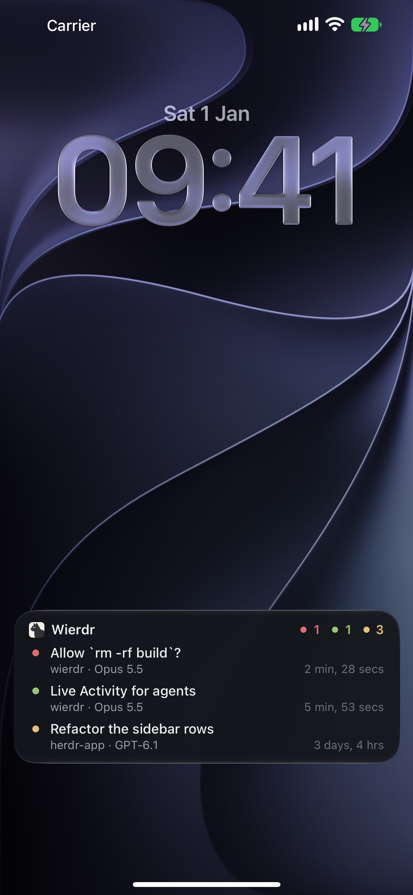
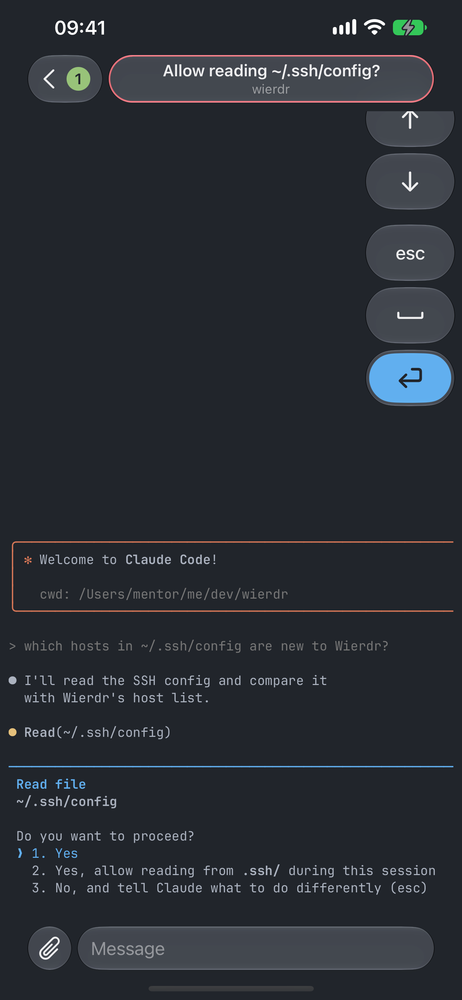
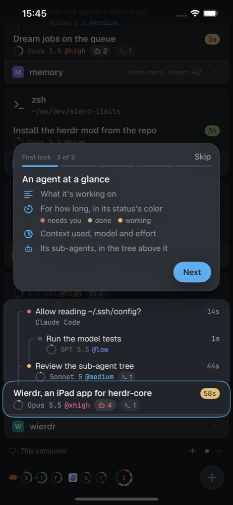

# Wierdr — что реализовано

Wierdr (`pw.xff.wierdr`) — нативное приложение для iPad и iPhone (SwiftUI + UIKit там, где нужен
терминал), которое подключается к **herdr-core** на Mac по SSH и показывает тот же мир,
что десктопный Herdr: спейсы, табы, сплиты, агентов и их живые терминалы. Внешний вид
сайдбара и терминальной панели перенесён с твоего сетапа (`wierd-layout`: `wierd-chrome`,
`wierd-agents`, `wierd-tabs`, `wierd-pane`, `agent-counts`) без панели лимитов.

Скриншоты: `docs/screenshots/` (`ipad-*` — демо‑режим, `terminal-*` — терминал,
`iphone-*` — iPhone, см. §7).

## 1. Подключение

- **Список хостов** (стартовый экран): добавить / изменить / удалить хост (адрес, порт, пользователь,
  способ входа). Хосты хранятся в `Application Support/hosts.json`, ключ — в Keychain; пароли не
  хранятся нигде.
- **SSH на нативном стеке Apple**: Network.framework (через SwiftNIO Transport Services) +
  SwiftNIO SSH + CryptoKit. На Mac выполняется `hc connect` (ищется в PATH, `~/.local/bin`,
  Homebrew, `~/.cargo/bin`, mise, nix — так же, как это делает сам herdr-core для `machine add`).
- **Вход по ключу**: ключ Ed25519 генерируется на iPad и хранится в Keychain (только это
  устройство). Публичный ключ показывается в редакторе хоста: Copy / Share.
- **Вход по паролю** (macOS sshd его поддерживает). Пароль приложение **не хранит**: спрашивает
  при каждом подключении (Connect, Retry, возврат к последнему хосту при запуске), с
  автозаполнением паролей iOS. Пока сессия жива, пароль лежит у неё в памяти для её же
  переподключений, и с ней уходит. Пароли, которые хранили сборки до 89, удаляются при запуске.
  После **каждого** входа по паролю открывается лист «Set Up <хост>» с секцией **Sign In**:
  **Install This iPhone’s Key** (iPad’s на iPad) добавит ключ устройства в
  `~/.ssh/authorized_keys` на Mac и переключит хост на вход по ключу. Та же кнопка — в
  Settings → Connection ([host-setup.md](host-setup.md)).
- **Проверка ключа хоста (TOFU)**: при первом подключении — алерт с отпечатком SHA256;
  при смене ключа — громкое предупреждение.
- **Настройка хоста** ([host-setup.md](host-setup.md)): после первого подключения к хосту
  приложение проверяет через `machine.exec` ядра демон Wierdr и харнессы агентов. Если
  что‑то просит человека, появляется лист «Set Up <хост>», один раз на хост, на iPad и на
  iPhone. Под каждой секцией — команды, которые выполнят её кнопки.
  - **Daemon** — `wierdrd` ([wierdrd.md](wierdrd.md)): **Install with Homebrew**
    (`brew tap wierdbytes/apps`, `brew install`, `brew services start`), **Start** или
    **Update**. Без Homebrew лист объясняет, что его нужно поставить.
  - **Agent Integrations** — строка на каждый найденный харнесс (pi, Claude Code, Codex;
    ищется в `PATH` логин‑оболочки): версия, есть ли интеграция (pi-wierdr, `cc@wierdr`,
    `codex@wierdr`), кнопка **Install …** или **Enable …**; слишком старый харнесс или Codex
    без python3 — объяснение. После установки — как она начнёт работать (новые сессии,
    `/reload-plugins`, доверить хуки Codex).

  Потом то же — в **Settings → Daemon** (состояние «Running · 0.1.0», кнопка, на iPhone —
  регистрация Live Activity) и **Settings → Agent Integrations**.
- **Переподключение**: при обрыве — автоматический реконнект с backoff; при возвращении
  приложения на передний план линия проверяется пингом и при необходимости поднимается заново.
  Баннер «Reconnecting…» в панели. Терминалы переаттачиваются сами (ядро присылает экран +
  2000 строк истории).
- **Автоподключение**: при запуске iPad и iPhone сами подключаются к последнему хосту (iOS
  часто выгружает приложения в фоне). После Disconnect — нет, до следующего Connect.
- **Демо‑режим** («Try the Demo»): тот же интерфейс на данных, повторяющих твой десктоп.
  Нарисованные агенты отвечают: отправленное из поля сообщения встаёт в их терминал твоим
  промптом, агент ~3 с работает (жёлтый) и заканчивает с ответом (зелёный; если он на экране —
  сразу idle, как вживую); шелл печатает, что в демо ничего не выполняется. Агенту, который
  ждёт тебя (scout: «Allow reading ~/.ssh/config?»), отвечают клавиши колонки: ⏎, y, 1, 2 —
  разрешить, esc, n, 3 — отказать, и он уходит работать. Колонка клавиш вытягивается свайпом
  влево и по нарисованному терминалу. Команды структуры (новый спейс/таб, сплит, закрытие,
  переименование) — по‑прежнему тост «not available in the demo».
- **Тур** (iPhone; §8): интерактивное обучение на демо, с подсказками и указателем на экране.
  Сам при первом запуске (хостов нет), «Take the Tour» на экране хостов и в Settings.
  Заголовки агентов демо — по‑английски, как интерфейс.

## 2. Сайдбар (один на iPad и iPhone)

Один и тот же сайдбар (`App/Sources/Sidebar`): на iPad — колонка рядом с панелью и оверлей
над скрытой, на iPhone (и в узком окне iPad) — первый экран, под панелью (§7). Из сайдбара
iPad — карточки спейсов (сворачиваются, перетаскиваются прямо в списке, git и сводка статусов
в свёрнутом виде) и шрифты (Geist, а модель, effort, возраст и папки — JetBrains Mono); из
списка iPhone — строки агентов в стиле Telegram, порядок снизу вверх, шапка внизу и кольца
лимитов. Всё, до чего дотягивается большой палец, внизу.

- **Список снизу вверх**, отражённый целиком: карточки спейсов, первая — нижняя, у шапки;
  спейсы этого компьютера ниже всех, спейсы добавленных машин — над ними; заголовок — под
  тем, что он называет (у карточки — внизу, под её строками; у машины — под её карточками),
  ближе к пальцу. Список стоит у нижнего края (короткий —
  прижат к шапке); карточка, что выросла или появилась (развернулась, пришёл агент), не
  двигает карточки под собой — сдвигаются верхние, в той же анимации. Карточка
  разворачивается вверх и сворачивается вниз, в свой заголовок, а заголовок стоит на месте
  (пружина 0,35 с без отскока; строки уезжают под заголовок, сводка статусов проявляется в
  нём); так же машина и дерево сабагентов. Строки уезжают под шапку и под статус‑бар
  (там лёгкое затенение, как у Telegram). Прокрутка — UIKit'овская, устроена как список
  Telegram: бросок к краю кончается обычным отскоком у настоящего края, палец, положенный на
  инерцию или отскок, сразу останавливает список и ведёт его дальше; тап по статус‑бару —
  к началу списка (вниз); пока список движется, справа — индикатор прокрутки.
- **Шапка** — внизу, одна строка 44 pt (её низ — в 28 pt над краем экрана, как поле
  сообщения на экране панели), 16 pt от краёв:
  - слева — **лимиты подписок**: по аккаунту иконка (Claude, Codex, …) и кольцо на каждый
    его лимит, все сразу (кроме `7d_oi`). Кольцо — полоска старого сайдбара, свёрнутая в
    круг: доля — дуга от 12 часов по часовой в цвете темпа (зелёный / жёлтый / красный) по
    тёмной дорожке, засечка поперёк кольца — сколько времени окна прошло; внутри — знак
    лимита: число окна (**5** — 5 часов, **7** — 7 дней), у лимита модели — её первая буква
    (**F** — Fable, O — Opus). Не помещаются рядом с кольцом статусов — у аккаунта только
    главное кольцо (закреплённого нет — с худшим прогнозом) рядом с иконкой, потом без
    иконок, а уж потом прокручиваются вбок. Тап по аккаунту — поповер со всеми его
    лимитами: подпись, полоска с тиком, процент цветом темпа (с `›`/`››`), время до сброса.
    Данные — документ `limits` в herdr-core, который пишет `@wierdbytes/pi-wierdr`
    ([pi.md](pi.md); прежде `@wierdbytes/pi-herdr` ≥ 0.4.0)
    при каждом ответе Claude/Codex (и плагины `cc@wierdr` у Claude Code,
    [claude-code.md](claude-code.md), и `codex@wierdr` у Codex, [codex.md](codex.md):
    аккаунт `codex.<slug>`, окна 5 ч и 7 дней, план, подпись — e‑mail); читается со всех
    подключённых машин, один аккаунт сливается. Нет данных — нет колец.
  - по центру — **кольцо статусов**: чёрточка на каждого агента от 12 часов по часовой,
    срочные первыми — ждут тебя (красные), закончили (зелёные), работают (жёлтые), — idle
    бледные, как дорожка; каждый сабагент — отдельный агент (закончивший — idle; фоновая
    работа Claude Code из его записей 7501 — нет, её уже показывает статус самого агента). Больше
    24 агентов — по дуге на статус, у каждого не меньше десятой части кольца. Внутри —
    число агентов самого срочного статуса его цветом (одни idle — их число, тускло).
    Крупнее колец лимитов, пунктиром — не спутать. Тап — **панель агентов** (ниже); меню
    по удержанию больше нет. Место ему — в первую очередь; стоит по центру, пока помещается, иначе сдвигается. Агентов нет —
    «Agents»; пока нет связи — «Connecting…» / «Reconnecting…» со спиннером, «Not
    Connected» (на iPhone над шапкой баннер с причиной и Retry).
  - справа, под правым большим пальцем, — **+** в стеклянном круге, единственная кнопка
    шапки: меню над ней — **Settings** (тема, размер шрифта терминала, отключиться,
    установка ключа, лицензии), на iPad **Hide Sidebar** (⌘B), затем новый спейс (терминал
    или установленный агент) в папке последней открытой панели, на её компьютере — ниже
    всех, ближе к пальцу.
- **Панель агентов** (тап по кольцу статусов, ⌘P): все агенты всех спейсов и компьютеров
  в виде строк сайдбара, **по статусам**: ждут тебя, закончили, работают, idle (агент — по
  самому срочному из себя и своих сабагентов), без статуса — в конце; внутри статуса
  закреплённые первыми, потом по последней смене статуса (порядок `Workspace.inbox`, тот же
  у Live Activity). Как сам список, **снизу вверх**: самый срочный и свежий — нижний, у
  поля; сабагенты деревом над своим агентом (свёрнутое — как в списке); справа на строке —
  чип спейса. Спейсов в панели нет, заголовков групп тоже: статус видно по цвету пилюли
  возраста. Панель — **в том же сайдбаре**: въезжает поверх карточек справа, как экран
  панели на iPhone (карточки уходят на 0,3 ширины влево и темнеют, та же пружина), и
  **смахивается вправо** в любом её месте, по тому же правилу отпускания; на iPad — в
  колонке сайдбара (и в оверлее), не задевая панели справа. Внизу — **поле fuzzy‑поиска**
  (как fzf) по заголовкам агентов, сабагентов и фоновых задач Claude Code: лучшие
  совпадения ниже, совпавшие буквы подсвечены, агент виден, если совпал он или его
  сабагент; Return — нижняя строка (агент или его лучше совпавший сабагент). При открытии
  тапом фокуса в поле нет (клавиатура — тапом по полю); ⌘P сразу ставит в него курсор
  (скрытый сайдбар iPad выезжает оверлеем). Справа от поля, пока клавиатура на экране, —
  стеклянный круг ⌨︎↓, он её убирает; прокрутка тоже; Esc в поле закрывает панель. Тап по
  строке — её агент (сабагент — как тап по его строке в списке), **панель остаётся**. Строки
  — **как в списке спейсов**: удержание — то же меню (Pin, Mark Unread/Idle, Split Right, Close
  Pane; у сабагента Show, Keep as Tab / Go to Its Tab, Close), с поднятой строкой; свайпы —
  те же, но **только от краёв строки** (зона ~1/6 ширины у каждого края) и от края внутрь:
  от левого вправо — Unread/Idle и Pin, от правого влево — Close. Свайп вправо из середины
  убирает панель, от самого края экрана (16 pt) — тоже; у строки без действий в эту
  сторону (сабагент вправо) свайп от края тоже убирает панель, а открытую строку свайп
  закрывает. В оверлее iPad свайп влево от правого края строки — Close, оверлей остаётся;
  из середины и от левого края свайп влево убирает оверлей, как везде. На
  iPhone экран агента въезжает поверх сайдбара, и «назад» возвращает в панель; на iPad
  строка агента в фокусе подсвечена. На iPad поле держится над клавиатурой через тот же
  `KeyboardCover`, что и поле сообщения. VoiceOver: кольцо — кнопка «Agents» со счётом по
  статусам, escape закрывает панель. Проверено на iPad (альбом, живое подключение: колонка и
  оверлей, смахивание, строка в фокусе подсвечена; меню строки, Close от правого края, Unread
  и Pin от левого, свайп влево из середины ничего не открывает, от края строки сабагента —
  панель уходит; меню списка спейсов как было; в оверлее — Close от правого края строки,
  свайп влево из середины убирает оверлей), на iPhone 13 Pro Max (живое: открыть,
  поиск с клавиатурой, смахнуть вместе с ней; меню и свайпы строк — как на iPad) и в симуляторах (агент из панели и «назад» в
  неё; ⌘P как `-open find` на iPad: курсор в поле, клавиатура, сайдбар над ней).
- **Ширина** (iPad): край сайдбара тянется пальцем или курсором (240 pt … 640 pt, не больше 60%
  окна), и в док‑режиме, и в оверлее. У дока и оверлея своя ширина, обе
  запоминаются. Двойной тап по краю возвращает 300 pt.
- **Оверлей** (iPad): при скрытом сайдбаре свайп вправо по терминалу (в любом месте; если открыта
  колонка клавиш — сначала закрывает её) или от левого края вытягивает его поверх панели
  (за пальцем). Закрывается свайпом влево (где угодно, по строкам тоже, кроме правого края
  строки: свайп влево оттуда открывает её Close, и в списке спейсов, и в панели агентов;
  открытую строку свайп закрывает, оверлей остаётся; свайп строки вправо — её Unread/Pin, в
  списке спейсов из любого места), тапом по затемнению, тапом по строке, кнопкой сайдбара
  или ⌘B. Проверено на iPad (альбом): Close от правого края строки спейса и агента, свайп
  влево из середины убирает оверлей, вправо по строке спейса — Unread и Pin. При пристыкованном сайдбаре свайп вправо по терминалу ничего не делает.
- **Машины**: заголовки «This computer» и добавленных машин (`hc machine add`, например `lf`)
  появляются, когда есть удалённые машины, — под своей группой карточек; сворачиваются
  (свёрнутая показывает бейджи статусов своих агентов; шеврон открытой смотрит вверх, на
  карточки); «+» создаёт спейс на этой машине.
  Спейсы удалённых машин читаются из их собственных документов `herdr-app` через ядро Mac.
- **Карточки спейсов**: заголовок (44 pt, внизу карточки) — аватар с буквой и цветом **из твоего десктопа**
  (`shared.json` → `space.colors`), имя (своё или автоматическое — по git‑репозиторию/папке
  первого терминала, как в Herdr), git‑хвост (`repo · branch`, ↑ahead ↓behind), в свёрнутом
  виде — бейджи статусов (сколько агентов ждут тебя, закончили, работают — кружки цвета
  статуса с числом; сабагенты считаются в спейсе родителя), шеврон «скрыть/показать строки»
  (запоминается; у развёрнутой смотрит вверх, на строки). Тап по заголовку: на iPad — выбрать спейс (выбранный подсвечен акцентом),
  на iPhone (там ничего не выбрано) — свернуть/развернуть. Long‑press — меню (заголовок
  поднимается над ним): Rename…, New Tab › (терминал или установленный агент), Close Space;
  VoiceOver — те же действия у заголовка. Над заголовком — строки спейса:
  сверху его терминалы и панели десктопа, под ними агенты, закреплённые — прямо над
  заголовком.
- **Перетаскивание спейсов**, как в `wierd-agents`: карточку берут за заголовок (пальцем —
  удержать и повести, как везде в iOS: меню спейса уходит, карточка поднимается; указателем —
  нажать и тянуть, меню — правым кликом) — она поднимается целиком, со строками (тень,
  акцентная рамка) и летит за пальцем, держась там, где её взяли, — и над панелью тоже, а
  карточки её машины расступаются там, куда она ляжет: на её месте пунктирный слот `accent`
  в её высоту. Отпустил над списком — карточка за 0,22 с въезжает в слот, на лету становясь
  обычной (рамка и тень гаснут), спейс переезжает (`space.move`: правка документа своей
  машины, десктоп видит новый порядок; список снизу вверх — карточка, опущенная ниже всех,
  становится первым спейсом). Пока палец за пределами списка, слот стоит на её прежнем
  месте; отпустил там — карточка прилетает обратно в него. Только среди спейсов своей
  машины; у верхнего и нижнего края (под шапкой) список прокручивается сам. Так же на
  iPhone (режима Reorder Tabs больше нет).
- **Строки — как строки чатов Telegram**, без большого аватара, во всю ширину карточки,
  разделители (отступ 16 pt; над закреплёнными и под терминалами — во всю ширину; под
  нижней строкой — нет). Агент (56 pt), две строки:
  1. заголовок (16 pt; у pi — его сессия из OSC 7501 `msg`; у Claude Code (`app:
     "claude-code"`) — название сессии из заголовка терминала (придуманное им или `/rename`),
     а `msg` (у него это мимолётная деталь: «1 shell still running», итог хода) — только
     пока он ждёт тебя или упал: вопрос, разрешение, ошибка; без говорящего заголовка —
     `msg`, дальше как у всех; у Codex (`app: "codex"`, `msg` он не шлёт) — имя его треда
     из заголовка терминала (`⠙ Fix the login redirect | wierdr` → «Fix the login
     redirect»: без спиннера, без мигающего `[ ! ] Action Required | ` / `[ . ] Action
     Required | ` и без последней части, если это имя проекта, как его считает Codex, —
     папка git‑корня или cwd); пока имени нет и в заголовке только проект — имя таба, если
     он назван, иначе «Codex»; так же в капсуле экрана панели, баннере, панели агентов и Live
     Activity), справа машина и возраст статуса (где
     у Telegram дата); возраст — на пилюле цвета статуса: ждёт тебя — красной, закончил —
     зелёной, работает — жёлтой; idle — просто серый текст;
  2. контекст — кольцо без числа: дуга заполнения от верха по часовой в цвете
     заполненности; за ним модель, `@effort` с цветами твоей лестницы (не хватает места —
     обрезается модель, `@effort` и кольцо целиком), бейджи сабагентов (бот — сабагенты с
     терминалом + внутренние у каждого терминала блока: больше из `agent.subagents` и его
     записей‑сабагентов, одна работа не считается дважды; тап сворачивает и разворачивает
     сабагентов всего дерева) и терминалов (`>_` — терминалы, запущенные им самим, + его
     фоновые шеллы Claude Code; терминалы его сабагентов — на их строках; тап показывает и
     прячет только их); справа — в панели агентов
     имя спейса на сером чипе, у закреплённого последней — булавка Telegram.

  Данные — из меток `agent.*`, которые пишет pi (как в твоём моде), без лишних запросов.
  У Claude Code — те же метки (`agent.app = claude-code`, модель, effort, контекст, кэш на
  1 ч по подписке, сабагенты) пишет плагин `cc@wierdr` из `Integrations/claude-code`
  ([claude-code.md](claude-code.md)); без него у Claude Code вместо модели — имя программы,
  без кольца. У Codex их пишет плагин Codex `codex@wierdr` из `Integrations/codex`
  ([codex.md](codex.md)): `agent.app = codex`, `agent.pid` (pid TUI, он же foreground
  терминала), модель в стиле pi (`GPT-6.1 Sol` → под знаком OpenAI «6.1 Sol»), effort
  Codex (`none|minimal|low|medium|high|xhigh|max|ultra`: `none` — цветом `off`, `ultra` —
  тем же побуквенным градиентом, что `max`), контекст и окно, сессия, число его
  сабагентов (`agent.subagents`, число в бейдже бота; они идут внутри процесса Codex — ни
  терминалов, ни записей 7501; по каждому работающему плагин пишет и `agent.subagents_meta`);
  кэша нет. Статус Codex сообщает сам (OSC 7501:
  `idle|working|blocked|done|error`, у blocked `kind`), и его `idle` — всегда idle,
  «закончил» (зелёный) — только его `done`, пока ход не просмотрен (счётчик `turn`
  herdr-core у Codex растёт и без законченного хода: на запуске, на `/new`, на каждом
  запросе разрешения); Mark Unread у Codex, сказавшего idle, не предлагается. herdr и
  Wierdr запускают его как `codex --no-daemon` (`programs.json`): без общего фонового
  сервера Codex ведёт сессию в процессе самого TUI, в терминале herdr-core, а не в сервере
  вне его (подробности — [codex.md](codex.md)).
  Терминал (60 pt): иконка программы, имя процесса и под ним папка с `~` и сокращением
  посередине; панель десктопа — её имя.
- **Сабагенты** (терминалы, запущенные агентом через `hc run`), как в `wierd-agents`: деревом
  над строкой агента (список снизу вверх: блок отражён — ближайший сабагент прямо над
  агентом, линии `├ ┌ │` идут вверх), в глубину. Сабагент — две строки: статус (никогда не
  «done» — он отчитывается родителю; error — красная точка) и чем занят (`msg`, иначе
  говорящий заголовок (у Codex — имя треда, как в строке агента), иначе имя `--name`), возраст; под ними, как у агента, —
  кольцо контекста (с той же позиции, что заголовок), модель, `@effort` и бейдж `>_`
  запущенных им терминалов. Обычный терминал — одна строка: иконка и имя. Метки строк
  (точка статуса, иконка терминала) стоят на одной оси на каждом уровне, а линия дерева к
  детям идёт ровно по оси метки родителя (у агента — по оси его кольца) и доходит до его
  точки; метка ребёнка — посередине между концом колена и началом заголовка. Сабагенты раскрыты
  по умолчанию, бейдж бота в строке агента сворачивает и разворачивает их всех. Терминалы
  — под бейджем `>_` того агента или сабагента, который их запустил (терминал, запущенный
  терминалом, — с ним): новые приходят свёрнутыми, тап по бейджу показывает их все, ещё
  тап — прячет; когда у агента не остаётся терминалов, бейдж пропадает, и следующие снова
  придут свёрнутыми. Оставленный (Keep) сабагент — всё ещё над родителем, не строкой своего
  таба; тап — его панель.
- **Фоновая работа Claude Code** (его записи OSC 7501 `records` — фоновые сабагенты,
  тиммейты и шеллы, пока идут, и сабагенты и тиммейты из метки `agent.subagents_meta`
  плагина `cc@wierdr`, пока живы; у Codex — из той же метки плагина `codex@wierdr`) — тоже
  строки дерева, в тех же линиях: под терминалом, что о них сообщает (агент строки или его
  сабагент), после его терминалов‑детей (дальше от агента), по id (у Claude сабагенты `a…`
  раньше шеллов `b…`). Сабагент и тиммейт выглядят как сабагент pi (две строки, 50 pt):
  точка статуса (работает — жёлтая, ждёт тебя — красная, простаивает — пустая: тиммейт между
  ходами, ждёт сообщения), заголовок задачи и сколько он в этом статусе; под ними модель,
  `@effort` и кольцо контекста (без плагина — только записи, пока работают, «Claude Code» на
  месте модели и без возраста). Фоновый шелл — одна строка 36 pt, как терминал: точка и
  заголовок; он под бейджем `>_` терминала, который о нём сообщает (свёрнут, пока не
  открыт). Терминала у них нет: ни панели, ни окна поверх, ни свайпов, ни меню; тап
  открывает терминал, который о ней сообщил (агента — его панель, на iPad фокус, на iPhone
  экран панели; сабагента — как тап по его строке). В кольцо статусов, бейджи карточек, Live
  Activity и срочность агента не идут.
- **Порядок строк в карточке — как у Telegram, снизу вверх**: закреплённые внизу (новый — в
  самом низу, место держат), над ними все по последней смене статуса (агента или его
  сабагентов), свежие ниже; групп по статусу нет; терминалы спейса — над агентами.
  Закрепление и открепление двигают строку пружиной списка Telegram (строка непрозрачная и
  проезжает поверх остальных), смена статуса переставляет без анимации.
- **Закреплённые — как у Telegram**: строка на сером фоне во всю ширину карточки, булавка в
  конце второй строки. Метка `herdr.pinned` хранит время закрепления (Unix,
  секунды) — десктоп видит любое непустое значение как «закреплён»; закреплённые на десктопе
  («1») — после закреплённых здесь.
- **Выбранная строка** (iPad): строка панели в фокусе (или сабагента, открытого поверх) — на
  подсвеченном фоне в акцентной рамке; карточка с ней прокручивается в поле зрения. На
  iPhone в списке нет «текущего» агента (§7).
- **Нажатие** подсвечивает строку через 0,08 с (сдвинул палец на 4 pt — гаснет); после тапа
  подсветка держится 0,5 с и гаснет за 0,4 с. Тап — панель агента (на iPad — фокус, на
  iPhone — экран панели).
- **Свайпы по строке** — как у Telegram: круглые кнопки 50 pt с подписью открываются в полосе,
  с которой уехала строка. Вправо — **Unread** (idle) или **Idle** (done), затем **Pin/Unpin**;
  влево — **Close** у агентов, сабагентов и терминалов (на всю высоту строки, без подписи;
  с вопросом; сабагент без панели — `terminal.kill` ему и его неоставленным сабагентам).
  Открывается дальше половины или рывком, полный свайп (за max(открыто + 20, 0,525 ширины))
  с вибрацией выполняет крайнюю. Открыта одна строка; прокрутка или тап мимо закрывают её.
  Long‑press — Pin, Mark Unread (`herdr.seen=turn-1`; не у Codex, сказавшего idle: его
  idle не станет done) / Mark Idle (`herdr.seen=turn`), Split
  Right, Close Pane (у сабагента: Show, Keep as Tab, Go to Its Tab, Close).
- **Меню строк и заголовков — как в Telegram**: удержание — строка (заголовок) сжимается и за
  0,32 с поднимается над размытым затемнённым экраном (iPad — только затемнение), под ней
  стеклянное меню; средний виброотклик. Тем же пальцем — по пунктам (подсветка, щелчок),
  отпустил — сработал; тап по пункту, мимо — меню уходит, тап по поднятой строке — открыть её.
  New Tab › — подменю на месте меню, с Back. Правый клик указателем — меню сразу.
- **Тап по сабагенту без панели**: на iPad — окно поверх всего (82%, как peek десктопа):
  полоса со статусом, заголовком, «from <родитель>», **Keep ↵** и **✕ esc**, под ней живой
  терминал (клавиатура — двойным тапом или кликом указателем). Пока окно открыто, колонка
  клавиш (свайп влево по его терминалу), клавиатура и поле сообщения — для сабагента
  (колонка выезжает у края панели, как всегда). Окно открылось или закрылось —
  колонка убирается, чтобы клавиши не ушли не тому.
  Тап мимо окна, ✕ или esc закрывают его, сабагент продолжает работать; esc и ↵ — кнопок
  окна, пока клавиатура не у терминала. **Keep** делает его табом сразу за табом родителя
  (за уже оставленными сабагентами того же родителя): метки `herdr.space`/`herdr.tab`,
  `terminal.keep`, правка документа — десктоп видит таб и тоже держит строку под родителем.
  На iPhone — экран панели на месте родителя (§7).
- **«Прочитано» синхронизировано с десктопом**: когда агент на экране, Wierdr поднимает
  общую метку `herdr.seen` — «done» гаснет и на Mac, как между двумя окнами Herdr.
- ⌘] / ⌘[ — следующая / предыдущая строка в том порядке, в каком они нарисованы (сверху вниз).

## 3. Терминальная панель (как `wierd-tabs` + `wierd-pane` + `agent-counts`)

- **Таб‑бар** (42 pt): «пилюли» табов с иконкой программы первого агента, именем (или номером),
  статусом и крестиком у активного; горизонтальная прокрутка. Long‑press — Rename / New Tab / Close.
- **«+» меню**: Terminal (⌘T), «Start an agent» — список агентов из таблицы программ Herdr с
  проверкой, что они установлены на машине (Claude Code, Codex, Pi, Cursor…), New Space (⌘N).
  Агенты запускаются через интерактивный login‑shell, как это делает Herdr.
- **Панели**: дерево сплитов таба с весами из документа, карточки (радиус 10, рамка, акцентная
  рамка у сфокусированной), заголовок панели: иконка, имя программы, cwd; кнопки split right /
  split down / zoom / close (на сфокусированной панели всегда видны, на остальных — в меню).
  Zoom панели (⌘⇧↩).
- **Терминал**: SwiftTerm (Metal‑рендер), JetBrains Mono 14 + Symbols Nerd Font (твой
  pi‑статуслайн рисуется корректно), кириллица/CJK/эмодзи, truecolor, bold/italic, TUI
  (vim, btop, less, pi, Claude Code), прокрутка истории, выделение и копирование, вставка
  (bracketed paste), мышь в TUI через трекпад (средствами SwiftTerm).
  Протокол — как у десктопа: `history: 2000`, display‑facts (цвета/размер ячейки), RESIZE при
  изменении сетки, FOCUS, кредиты потока, ответы эмулятора как AUTOMATIC_INPUT, переаттач после
  `restarted` и обрыва, оверлей «Process exited (код)».
- **Клавиатура**: аппаратная (Magic Keyboard) со всеми модификаторами; Option = Alt;
  раскладка из твоего `keys.json`: ⌥←/⌥→ (слово), ⌥⌫, ⌘←/⌘→ (начало/конец строки), ⌘⌫,
  ⌘C/⌘V, ⌘. = Esc. Экранная клавиатура с панелью клавиш: esc, ctrl (липкий), alt, tab,
  `~ | / \ - _ : ; ` ' "`, стрелки.
  Сайдбар и панель кончаются над панелью клавиш (или над полем сообщения): над
  пристыкованной клавиатурой, у нижнего края при плавающей или аппаратной.
- **Поле сообщения — всегда под панелями** (одно на все панели таба, на месте бывшего
  статус‑бара; как на iPhone, §7): кнопка‑скрепка и поле «Message to Pi» — кому уйдёт (панели в
  фокусе), края выровнены с карточками панелей. Тап по полю — клавиатура, поле над ней (у нижнего
  края при плавающей); двойной тап по терминалу — клавиатура уходит, поле сужается до двух
  строк. Пока клавиатура у самого терминала (двойной тап, клик указателем), поля нет. Другая
  панель в фокусе — клавиатура поля уходит, в поле черновик той панели. У окна сабагента — своё
  поле внизу окна.
- **Ввод пальцами — свайп влево по терминалу** (как панель клавиш на iPhone, §7). **Свайп
  влево** в любом месте терминала (по панели в сплите — она получает фокус) вытягивает колонку
  крупных клавиш iPhone (Paste, ^R ^L ^D ^J ^C, ! @ /, n y 3 2 1, ⇧tab tab, ← → ↑ ↓, esc, пробел, ⏎;
  при открытой клавиатуре сверху ещё Hide) у правого края за пальцем; она открывается с ⏎ на
  высоте, где начался свайп, — под большим пальцем. Клавиши идут в панель в фокусе.
  VoiceOver: действие «Keys» у терминала.
  - Закрыть колонку — только свайпом вправо (по колонке или терминалу). Тапы рядом с ней —
    клики в программу; двойной тап рядом — клавиатура терминала или убрать её (колонка
    остаётся).
  - **Тап пальцем по терминалу** — клик в программу, и при открытой клавиатуре тоже: она
    остаётся (прокрутка тоже идёт в терминал). **Двойной тап** — клавиатура терминала, при
    открытой клавиатуре (терминала или поля) — убрать её (как на iPhone, §7): в программу
    ничего не уходит, слово не выделяется.
    **Клик указателем** (трекпад, мышь, Universal Control) — как на Mac: даёт терминалу ввод и
    клавиатуру не прячет; двойной/тройной клик выделяет слово/строку.
  - Клавиатура переходит за фокусом: если она была у терминала, другая панель в фокусе
    получает её сама.
  - Пока открыт оверлей сайдбара, колонки нет.
- Статус‑бара со счётчиками агентов больше нет (его место — у поля сообщения): статусы видны
  в строках сайдбара, к следующему агенту — ⌘] / ⌘[.
- **Тосты** с ошибками команд.

## 4. Создание и изменение структуры (совместимо с десктопом)

Все команды повторяют семантику `herdr-app` (см. `docs/research/herdr-app-model.md` §4):
сначала запускается терминал с метками `herdr.space`/`herdr.tab`/`herdr.seen` и `keep: true`,
затем документ `herdr-app` в ядре правится compare‑and‑swap’ом с проверкой инвариантов
(при конфликте — перечитать и повторить намерение, а не старый документ). Неизвестные поля
сохраняются. Десктоп видит изменения в течение ~0.5 с.

- **New Space** (⌘N, «+» в шапке сайдбара и у машины, меню) — в папке сфокусированной панели
  (как в Herdr), первым в блоке своей машины: документ общий, так что на десктопе он сверху,
  а в сайдбаре iPad и iPhone (он снизу вверх) — нижней карточкой, у шапки. Если десктоп успел
  подхватить терминал раньше и поставил спейс в конец, наша запись переносит его в начало.
- **New Tab** (⌘T, «+») — shell или агент, сразу после активного таба.
- **Split Right / Down** (⌘D / ⌘⇧D) — с правилами весов Herdr (`Node::split`).
- **Close Pane / Tab / Space** (⌘⇧W / ⌘W / меню) — с подтверждением, если внутри работают
  агенты (Close Pane — и если в панели живой терминал); терминалы и их сабагенты завершаются; последний таб закрывает спейс.
- **Rename Space / Tab** (меню; пустое имя = автоматическое).
- Если терминал завершился сам (`exit`), его панель убирается из документа (как делает
  десктоп), даже когда десктоп закрыт.

Проверено вживую на твоём ядре (из симулятора через SSH): создание спейса, переименование,
новый таб, split right + split down (три живых zsh с твоим powerline‑промптом), закрытие
спейса — десктоп показал и затем убрал спейс (он ушёл в `recent`), все терминалы завершились.

## 5. Горячие клавиши (аппаратная клавиатура)

| Клавиши | Действие |
|---|---|
| ⌘T / ⌘N | новый таб / новый спейс |
| ⌘W / ⌘⇧W | закрыть таб / панель |
| ⌘D / ⌘⇧D | сплит вправо / вниз |
| ⌘⇧↩ | zoom панели |
| ⌘⌥ ←↑→↓ | фокус соседней панели |
| ⌘] / ⌘[ | следующий / предыдущий агент (строка сайдбара) |
| ⌘⇧] / ⌘⇧[, ⌃Tab / ⌃⇧Tab | следующий / предыдущий таб |
| ⌘⌥] / ⌘⌥[ | следующий / предыдущий спейс |
| ⌘1…⌘9 / ⌃1…⌃9 | таб N / спейс N |
| ⌘B | показать/скрыть сайдбар |
| ⌘P | быстрый переключатель |
| ⌘, | настройки |

Удерживая ⌘, iPadOS показывает все команды (меню Space / Pane / Go).

## 6. Архитектура (кратко)

`Packages/WierdrKit` — всё, кроме UI (общее для iPad и iPhone):
`HerdrCore` (протокол herdr-core: фреймы, JSON‑RPC, attach‑стримы, события, документы),
`HerdrSSH` (SSH‑транспорт, ключи, known hosts), `WierdrModel` (живая модель + команды,
`WorkspaceEngine`), `wierdr-cli` (отладка на Mac: `wierdr-cli ws`, `ls`, `doc`, `events`, `attach`),
`WierdrActivity` / `WierdrPush` / `wierdrd` (Live Activity агентов, §7; демон — [wierdrd.md](wierdrd.md)).
`App/Sources` — SwiftUI. Подробно: `docs/architecture.md`, `docs/hc-protocol-client.md`,
`docs/ssh.md`. Тесты: `make test` (unit), `WIERDR_LIVE=1` / `WIERDR_SSH_LIVE=1` — живые.

## 7. iPhone

Та же сборка (`TARGETED_DEVICE_FAMILY 1,2`), тот же `WierdrKit` и те же команды; на iPhone
(в любой ориентации) и в узком окне iPad сайдбар (§2, тот же, что на iPad) не рядом с
панелью, а **первый экран, как список чатов Telegram, и одна панель на весь экран, въезжающая
поверх него, как чат** (`App/Sources/Phone/`). Широкий iPad остался со сплитами; панель клавиш и поле сообщения там
те же, свайпом влево по терминалу (§3).

- **Сайдбар — первый экран**, панель — экран поверх него, как чат поверх списка чатов Telegram.
  Тап по строке — панель въезжает справа на всю ширину, список уходит под неё на 0,3 ширины
  влево и темнеет (чёрный до 10 %); пока панель едет, у неё скруглённые углы экрана и лёгкая
  тень. Пружина Telegram (iOS 26): критически затухающая, отклик 0,3 с. Назад — кнопка «‹» в
  верхней панели или **свайп вправо в любом месте панели** (кроме правых 16 pt; если открыта
  панель клавиш — сначала закрывает её; по выделению в терминале — тянет выделение): панель
  едет за пальцем, отпустил — уезжает или возвращается по правилу UIKit (куда она попала бы
  через 0,35 с с этой скоростью и ускорением: дальше 187,5 pt — уезжает; быстрый рывок от
  края — ×4,25), пружиной (отклик 0,3 с, затухание 0,85) со скоростью пальца; свайп может
  подхватить панель, ещё въезжающую. Клавиатуры уходят в начале свайпа. **В списке нет
  «текущего» агента**: раз ты в списке, никакая панель не открыта — ни рамки фокуса, ни
  прокрутки к ней; ушедшая панель убирается из иерархии (её терминал отключится позже).
  При запуске открыт список.

- **Сайдбар — под одну руку**, как на iPad (§2): карточки спейсов снизу вверх, шапка внизу
  (лимиты, кольцо статусов, +), строки агентов в стиле Telegram; спейсы
  сворачиваются тапом по заголовку и переставляются перетаскиванием за заголовок. Полосы
  табов спейсов, листания между ними и режима Reorder Tabs больше нет: фильтр — свёрнутые
  карточки, порядок — перетаскивание. Все агенты по статусам и поиск — тапом по кольцу
  статусов (панель агентов, §2).
- **Тап по сабагенту** показывает его на весь экран, как панель агента, на месте родителя:
  капсула — в обводке цвета его статуса (как в списке), заголовок — чем занят; в меню (тап по капсуле) — **Keep as Tab**
  и **Back to <родитель>**. Клавиши, клавиатура и поле сообщения — его.
- **Панель агентов на iPhone** — часть первого экрана (сайдбара), а не экран поверх всех:
  въезжает справа поверх карточек, **смахивается вправо в любом месте**, как экран панели
  (едет за пальцем, клавиатура уходит в начале свайпа, отпустил — уезжает или возвращается
  по правилу UIKit). Агент из неё открывается экраном панели поверх сайдбара, свайп назад
  возвращает в панель (с тем же запросом), ещё один — к карточкам. ⌘P с экрана агента —
  назад в сайдбар, панель уже на месте. С клавиатурой поле над ней, за стеклом клавиатуры —
  фон сайдбара.
- **Экран панели** (тап по строке): одна панель на весь экран, без рамок, терминал от края
  до края (отступы 8 × 6 pt), шрифт 12 pt (~57 колонок в портрете).
  - Верхняя панель — как шапка чата Telegram: две стеклянные пилюли высотой 44 pt на фоне
    терминала, без линии и своего цвета, на одной линии; стекло и отступы от краёв — как у
    поля сообщения (26 pt у скруглённых углов экрана).
  - Слева **кнопка «назад»** Telegram — стеклянный круг с **«‹»**. Пока среди других агентов
    (кроме того, что на экране) есть не idle — рядом с «‹» круглый бейдж с числом агентов с
    самым срочным статусом (needs you, затем done, затем working; сабагенты считаются, как в
    кольце статусов шапки списка), залитый цветом этого
    статуса; круг растягивается в капсулу. Тап — назад в список.
  - Дальше стеклянная **капсула заголовка**, текст по центру, как у Telegram: первая строка —
    заголовок агента или имя программы (15 pt, полужирный, длинный обрезается «…»), вторая —
    спейс (12 pt, серый). Значка статуса нет: капсулу обводит линия цвета статуса агента
    (1.5 pt, как кайма Live Activity вокруг Dynamic Island; needs you, done, working), стекло
    под ней обычное; у idle и терминалов линии нет. Модели, effort и контекста здесь
    нет (они — в строках списка).
    **Тап по капсуле** — меню панели. Капсула на это время вырастает влево на всю ширину
    (кнопка списка уезжает влево), а если заголовок не уместился в строку — и вниз поверх
    терминала (терминал не меняет размер): до 4 строк заголовка и строка спейса. Когда меню
    уходит, капсула сжимается обратно и кнопка возвращается; всё анимировано. Меню выезжает
    вниз из-под капсулы (по центру, без сдвига вбок) и не закрывает её; оно в
    том же стекле, плотнее, чтобы терминал не просвечивал; строки как у системного меню.
    Pin, Unread/Idle; New Tab (терминал или установленный агент) и Split (вправо/вниз)
    раскрываются на месте; размер текста (− / + меню не закрывают — можно нажать несколько раз
    подряд); Close Pane/Tab. Тап мимо меню (или снова по капсуле) закрывает его и в терминал не
    уходит. Settings — в меню + шапки сайдбара, Rename Space — меню карточки спейса;
    переименовать таб на iPhone нельзя. Меню своё, не системное: системное на iOS 26+ вырастает
    из своей кнопки и прячет её.
  - Полосы панелей спейса нет: другие панели — в списке.
  - Если панель закрылась (здесь, на десктопе, или процесс завершился) — назад в список.
- **Ввод**: под терминалом всегда **поле сообщения** (по образцу Telegram, см. ниже); его нет,
  только пока клавиатура у самого терминала.
  - **Поле сообщения** — как композер Telegram для iOS (его геометрия, стекло и анимации; цвета
    — из темы Wierdr): слева кнопка‑скрепка (стеклянный круг 40 pt), справа от неё поле (стеклянная
    капсула высотой 40 pt, радиус 20; на iOS 26+ — Liquid Glass, раньше — его рисованная замена;
    стекло поля, в отличие от скрепки, не вспухает под пальцем: иначе оно забирало первый тап
    у пунктов меню скрепки над полем),
    системный шрифт 17 pt, плейсхолдер «Message». Без клавиатуры панель отступает от краёв экрана
    (как у Telegram: 26 pt по бокам, 28 pt от низа — у скруглённых углов), с клавиатурой — 8 pt
    по бокам и над клавиатурой; переход — пружиной клавиатуры. Справа от поля кнопок пока нет
    (место под голосовой режим).
  - **Тап по полю** — клавиатура (системное поле: диктовка, автокоррекция, любой язык; курсор —
    куда тапнул). Поле растёт вверх с каждой строкой (0,1 с), до предела Telegram (место над
    ним минус 120 pt, не больше 12 строк), дальше прокручивается. **Двойной тап по терминалу** —
    клавиатура уходит мгновенно, поле сужается до двух строк (короткий черновик — до одной) —
    окна в черновик как он есть (с переводами строк), каждый раз с первой строки; пальцем его
    можно прокрутить по строкам (останавливается на целой строке);
    тап — клавиатура, курсор там, куда тапнул, поле снова во весь текст.
  - **Кнопка отправки** — внутри поля справа внизу, акцентная капсула с бумажным самолётиком
    Telegram; появляется с первым символом и уходит с последним, как у Telegram: из точки у края
    поля (масштаб 0,001 → 1, сдвиг 17 pt), из размытия 4 pt, проявляясь за 0,2 с, самолётик
    влетает снизу слева; кривая 0,4 с (0.38, 0.7, 0.125, 1). Нажатие — кнопка проседает до 0,75.
    Отправка: текст уходит в программу одной вставкой (bracketed paste, если программа его
    включила — переводы строк остаются в сообщении) и затем Return; поле очищается, клавиатура
    уходит (смотреть ответ). Long‑press: «Insert Without Return», «Clear». Return с аппаратной
    клавиатуры отправляет (⇧Return — новая строка; в пустом поле — просто Return в программу),
    Return экранной — новая строка. Для агентов — заглавные и автокоррекция, для шелла — ввод
    как есть; «умные» кавычки клавиатура не ставит, тире — только в тексте для агента;
    оставшиеся «умные» кавычки и тире у флагов при отправке становятся `"` `'` `--`. Текст —
    черновик этого терминала (другая панель — свой черновик).
  - **Скрепка** — меню: **Photo Library** (системный выбор фото, без доступа ко всей
    библиотеке), **File** (любой файл из «Файлов», до 8 МБ), **Paste Image** (картинка из
    буфера). Wierdr кладёт файл рядом с терминалом на его машине (`terminal.put`, как Ctrl+V
    картинки на десктопе: `~/.local/state/herdr-core/…/files/<терминал>/`, удаляется вместе с
    терминалом) и дописывает его путь в поле (с пробелом после) — остаётся дописать, что с ним
    сделать; если выбор забрал клавиатуру у поля, она возвращается. Скриншоты остаются PNG, фото
    (HEIC и др.) становятся JPEG, всё больше 2048 px уменьшается; файлы — как есть. Пока файл
    грузится, на месте скрепки — индикатор.
  - **Клавиатура терминала — двойным тапом по терминалу** (на iPad так же): печатать прямо в
    терминал, системная клавиатура и над ней клавиш‑бар терминала — esc, ctrl, alt, tab,
    символы, скрыть (стрелок в нём на iPhone нет, они в панели клавиш, на iPad остались). Поле
    сообщения на это время скрыто. Двойной тап — не клик: в программу ничего не уходит, слово
    не выделяется (выделение — в меню долгого тапа). VoiceOver: действие «Terminal Keyboard» у
    терминала.
  - **Тапы по терминалу** — клики в программу (pi, vim с мышью; ссылки открываются), прокрутка
    — прокрутка; клавиатуру они не открывают и открытую (терминала или поля) не убирают. Убрать
    клавиатуру — **двойным тапом по терминалу**, мгновенно, без анимации (рядом с открытой
    панелью клавиш тоже; панель остаётся). Пока клавиатура открыта, клик уходит в программу
    чуть позже — после того как ясно, что второго тапа не будет.
  - **Панель клавиш** у правого края — ответить агенту (выбрать вариант, подтвердить,
    прервать) без клавиатуры или вместе с ней (тогда панель — над клавиатурой, клавиши её не
    убирают). Свайп влево в любом месте терминала (в основном
    горизонтальный: вертикальный — прокрутка терминала; не во время перетаскивания выделения)
    вытягивает её за пальцем (VoiceOver: действие «Keys» у терминала). Ни язычка у правого
    края, ни отдельного свайпа от края нет. Узкая колонка 96 pt без подложки; клавиши — пилюли в
    стекле поля сообщения и верхней панели (Liquid Glass на iOS 26+, до него — его нарисованная
    замена), 52 pt высотой, во всю ширину колонки, системный шрифт и цвет темы; ⏎ — акцентная
    пилюля внутри стекла, как кнопка отправки. Нажатие гасит значок, как у скрепки (⏎ чуть
    проседает). Между клавишами виден терминал. Колонка
    прокручивается и каждый раз открывается с ⏎ (внизу колонки, где самые частые клавиши) на
    той высоте, где начался свайп, — под большим пальцем (с открытой клавиатурой — внизу
    колонки). Прокрутка за край возвращает колонку туда, где крайняя клавиша видна целиком, а
    следующая — наполовину: вверх — ⏎ у верха колонки и половина пробела над ним, вниз — первая
    клавиша у низа колонки и половина следующей под ней (с клавиатурой Hide и Paste, без неё
    Paste и ^R); отпущенная за краем — на ходу или после остановки — за ~0,3 с одним плавным
    движением. Когда места становится меньше (появилась клавиатура, выросло поле сообщения),
    колонка сдвигается, только если иначе нарушились бы эти правила, — с анимацией, ровно до
    ближайшего допустимого положения; когда места становится больше (клавиатура ушла, поле
    сжалось), колонка стоит на месте.
    Сверху вниз: при открытой клавиатуре **Hide** — убрать её (без клавиатуры на её месте
    пусто, поэтому, когда она появляется, ничего не сдвигается); **Paste** (текст из буфера: в
    сообщение, пока у поля клавиатура, иначе в программу вставкой, без Return); ^R ^L ^D
    ^J ^C; ! @ /; n y 3 2 1; ⇧tab tab; ← → ↑ ↓ (повтор при удержании);
    esc, пробел, ⏎ (акцентная). Клавиши идут прямо в программу, даже пока пишется сообщение. Клавиши
    панель не закрывают (↓ ↓ ⏎ — три тапа), каждая — лёгкая вибрация. Закрыть — только свайпом
    вправо (по панели или по терминалу); тапы рядом с ней — клики в программу. Двойной тап
    рядом с панелью — клавиатура терминала (без клавиатуры) или убрать её; панель остаётся. Свайп вправо по терминалу
    без панели — назад в список.
- **Размер текста**: щипок двумя пальцами по терминалу (9…24 pt, бейдж с размером; терминалы
  переаттачиваются в новый размер), или − / + в меню капсулы заголовка (меню не закрывается), или Settings.
- **Баннер** сверху, пока ты в панели: другой агент начал ждать тебя или закончил — аватар,
  статус, заголовок; тап — перейти, свайп вверх — убрать; лёгкая вибрация.
- Экран не гаснет, пока на нём работающий агент (заблокированный iPhone рвёт соединение).
- **Сразу в список**: при запуске iPhone сам подключается к последнему хосту (§1,
  «Автоподключение»). После Disconnect в настройках — нет, до следующего Connect.
- Альбомная ориентация: то же самое.
- «Прочитано» (`herdr.seen`) — только для панели на экране; в списке ничего не отмечается.
- **Live Activity агентов** (экран блокировки, Dynamic Island, Smart Stack часов) — пока
  какой‑нибудь агент работает, закончил или ждёт тебя, и ещё 2 часа после (показывает
  «idle»), даже когда Wierdr закрыт. Счётчики
  (точки цвета статуса; сабагенты считаются, как в кольце статусов шапки списка), до 3 самых срочных агентов в порядке списка в две строки (статус, заголовок; под
  ним спейс · модель и сколько в этом статусе: `5 min, 25 secs`, тикает само), тап по
  агенту открывает его панель. «Нужен ты» зажигает экран со звуком, «закончил» — без звука. Её шлёт `wierdrd` на Mac через APNs (его ставит само
  приложение, §1); приложение регистрирует iPhone в ядре при подключении (Settings → Daemon:
  «Live Activity: On <компьютер>»)
  и берёт там ключ печати: Apple видит в пушах только счётчики, alert — «Needs you» /
  «Done» без имён; без ключа — счётчики и «Open Wierdr to see the agents». Без своего
  ключа APNs (без `push.json`) демон шлёт пуши через релей Wierdr (`relay.wierdr.workat.dev`): приложение
  получает там право на свой токен через App Attest ([relay.md](relay.md)).
  Настройка и устройство: [live-activity.md](live-activity.md).

- Тексты «This iPhone's key», «Install This iPhone's Key on …» и т. п. называют устройство.
- **Тур по приложению** — §8.

Ещё: `iphone-pi-live.png` (pi на ширине телефона), `iphone-banner-dark.png`,
`iphone-spaces-light.png` (таб спейса с закреплённым агентом и терминалом), `iphone-landscape-dark.png`, `iphone-compose-live.png` (живой zsh
с клавиатурой). Снимки экрана панели сделаны ещё со старой строкой ввода внизу (быстрые
клавиши, compose), до поля сообщения в стиле Telegram; панели клавиш на них нет.

## 8. Тур по приложению (iPhone)

Интерактивное обучение на демо: подсказка в карточке и указатель на экране, а каждое
действие ты делаешь сам (`App/Sources/Tutorial`). Пока только раскладка iPhone; на iPad
кнопок тура нет.

- **Начинается на экране хостов**: сам — при первом запуске (хостов нет и тур ещё не
  проходил); «Take the Tour» — под «Try the Demo» на экране хостов и в Settings (из живого
  подключения — отключает, тур всегда с экрана хостов; из демо — выходит из него). Первая
  карточка — «Welcome to Wierdr»: зачем приложение (агенты Herdr работают на Mac, Wierdr —
  в кармане: кто ждёт тебя, ответ в один тап, напрямую по SSH без сервера), «about 2
  minutes»; **Start Tour** или **Not Now**.
- **Как выглядит**: экран затемнён, кроме того, на что показывает шаг (вырез с акцентной
  обводкой: у шага с жестом она «дышит», у пояснения — тонкая и неподвижная), и того, что шаг
  показывает с ним (`spotlight`: Add Host рядом с Try the Demo, вся карточка спейса с её
  заголовком, дерево сабагентов над строкой агента, строка агента в панели под строкой его
  сабагента, терминал с ответом агента); места, куда ещё можно пальцем (терминал для свайпа
  назад, колонка клавиш), притемнены слегка; у шага «смахни панель» вырез — вся панель.
  Указатель — белая точка в акцентном кольце — через 0,7 с показывает жест на месте: тап,
  свайп вправо/влево (с Reduce Motion — стоит); на маленьких целях
  (кольцо статусов) он меньше и виден только вокруг тапа, на «‹» с бейджем и лимитах — у
  первой части. Карточка — у того, что показано (под ним в верхней половине экрана, иначе
  над; у того, что во весь экран, — внутри, под шапкой), не под клавиатурой и не поверх
  колонки клавиш (сужается рядом с ней); у поповера лимитов — над ним.
- **Карточка**: глава и номер в ней («Someone needs you · 2 of 4»), сегмент на главу,
  **Skip**; заголовок, одна‑две фразы «что это и зачем», где нужно — список с метками
  (строка агента — с легендой статусов цветными точками, лимиты, итоговая памятка), мелкая
  приписка; внизу — что сделать («Tap the ring», «Swipe left on the terminal» у символа
  жеста) или **Next** у пояснений; сделал — на миг **✓ Done**, и результат виден на экране
  (сложенная карточка со сводкой, закреплённая строка). Шрифты — по Dynamic Type.
- **Делай сам**: палец проходит только в вырез (и в места, которые шаг добавляет); тап мимо —
  карточка вздрагивает, обводка вспыхивает; тап по подсвеченному у пояснения — как Next. Шаг
  идёт дальше сам, когда сделано; внутри шага действие следует за тобой: после свайпа строки —
  «Tap Pin» на кнопке, после тапа по полю — «Type anything, then send», пока агент отвечает —
  «It's answering…», колонка клавиш закрылась — «Swipe left for the keys again». Шаги, где
  ищешь в панели агентов и закрываешь то, что открыл (лимиты), ничего не затемняют и не блокируют. Меню, которое
  ты открыл сам по ходу (удержание строки, тап по заголовку панели), — без затемнения и
  подсказки, пока не закроешь. Если палец всё же увёл приложение не туда, подсказка прячется,
  и через 0,8 с тур возвращает экран на место; результат поиска открыл экран — шаги «Back to
  the agents» и «Back to your spaces»; если цель шага не появилась за 1,5 с — в карточке
  появляется Next.
- **Skip** спрашивает в той же карточке («End the tour? You can take it again from the host
  list or Settings.» — Continue / End Tour); после конца или пропуска сам тур больше не
  начинается.
- **Сценарий** (19 шагов, пять глав): Welcome → **First look**: тап «Try the Demo» (Add Host
  подсвечен: «Your Mac comes later»), **сложить карточку** wierd-limits (список снизу вверх,
  под большой палец; свёрнутая — с зелёным бейджем своего done), строка агента списком
  (заголовок, время в цвете статуса с легендой, контекст/модель/effort, сабагенты деревом
  над ней) → **Someone needs you**: **тап по кольцу статусов — панель агентов**, **тап по
  ждущему** (по статусам, ждущий — нижний со своим агентом; сабагент scout на месте
  родителя, спрашивает про чтение ~/.ssh/config — и в строке, и в терминале), **свайп
  влево — клавиши** (не закрывают терминал), **⏎ — разрешить**, **назад — в панель** (‹ с
  бейджем или свайп), **смахнуть панель — к спейсам** → **Talk to an agent**: **тап — экран агента** (размер под телефон,
  клик на Mac возвращает), **сообщение** (как набранное на Mac; скрепка — фото и файлы),
  **ответ и назад** (терминал не затемнён, пока агент отвечает; тап по заголовку — меню
  панели) → **Tidy and find**: **свайп вправо и Pin** (влево — Close, удержание — остальное;
  закреплённые внизу карточки и на Mac тоже), **кольцо — панель**, поиск («login»), смахнуть
  (открыл результат — назад в панель и смахнуть) →
  **Your limits**: **тап по лимитам**, поповер списком (дуга — доля по темпу, засечка —
  прошедшее время, 5/7/буква модели, ›› — быстрее времени), закрыть → **You're all set**:
  памятка жестов (свайп влево — клавиши, вправо — назад, кольцо — все агенты и поиск, удержание — меню,
  «+» — новый спейс, Settings, тур) и Live Activity; Add My Mac (выход из демо и редактор
  нового хоста; если хосты уже есть — Back to Hosts) или Keep Exploring (остаться в демо).

Проверено (сборка 82): весь сценарий — в симуляторе iPhone 13 Pro Max (iOS 18.4, тёмная и
светлая тема; тап по подсвеченному как Next; подэтапы Pin, сообщения, ответа и закрытой колонки
клавиш; меню панели и строки по ходу; результат Go to и «Back to the list»; Skip) и на iPhone
13 Pro Max (iOS 27.2.1: из Settings живого подключения, все шаги, назад свайпом, Back to Hosts и
снова Connect). iPad: тура нет, его экраны не менялись (кроме английских заголовков демо);
на устройстве не смотрели.

Панель агентов вместо Go to: главы Someone needs you и Tidy and find пройдены в
симуляторе iPhone 13 Pro Max (iOS 27): кольцо → панель → scout → клавиши → ⏎ → назад в панель →
смахнуть; кольцо → «login» → результат → назад → смахнуть.
