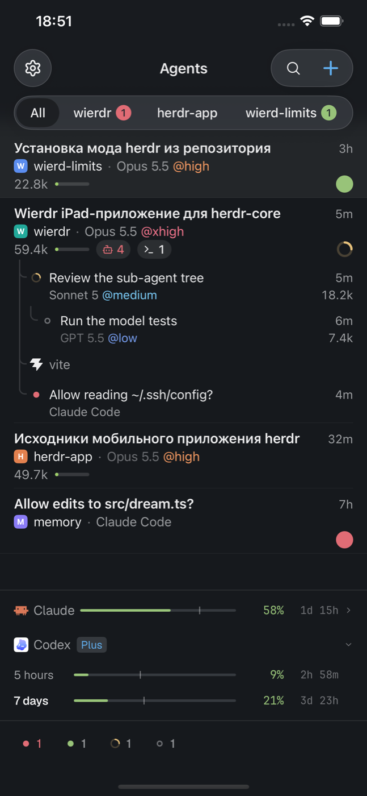
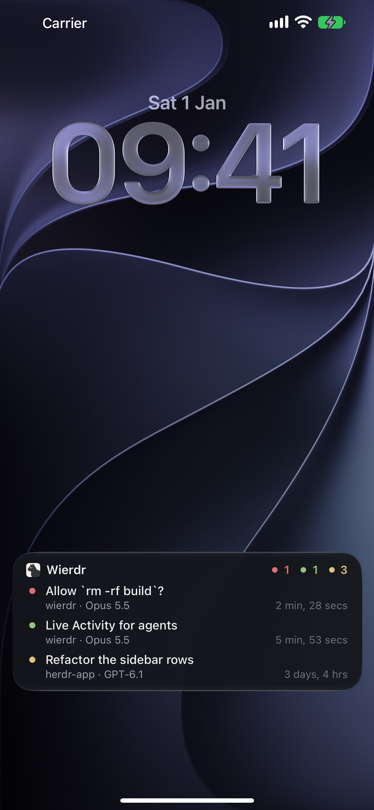
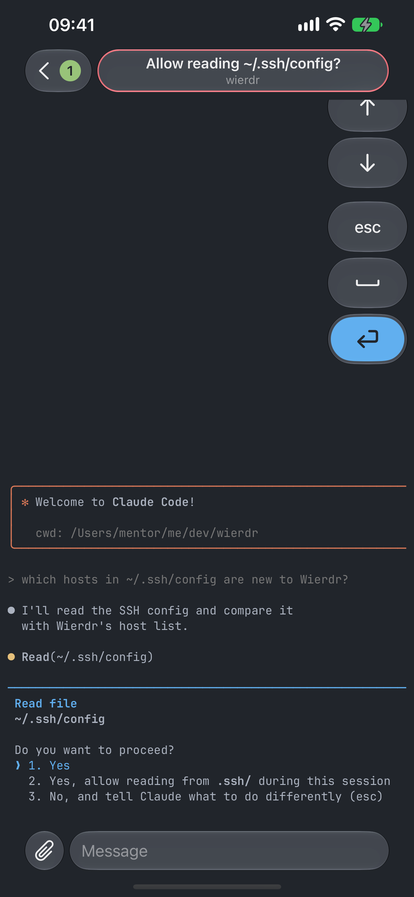

# iPhone

Та же сборка (`TARGETED_DEVICE_FAMILY 1,2`), тот же `WierdrKit` и те же команды; на iPhone
(в любой ориентации) и в узком окне iPad сайдбар ([sidebar.md](sidebar.md), тот же, что на iPad) не рядом с
панелью, а **первый экран, как список чатов Telegram, и одна панель на весь экран, въезжающая
поверх него, как чат** (`App/Sources/Phone/`). Широкий iPad остался со сплитами; панель клавиш и поле сообщения там
те же, свайпом влево по терминалу ([panel.md](panel.md)).

- **Сайдбар — первый экран**, панель — экран поверх него, как чат поверх списка чатов Telegram.
  Тап по строке — панель въезжает справа на всю ширину, список уходит под неё на 0,3 ширины
  влево и темнеет (чёрный до 10 %); пока панель едет, у неё скруглённые углы экрана и лёгкая
  тень. Пружина Telegram (iOS 26): критически затухающая, отклик 0,3 с. Назад — кнопка «‹» в
  верхней панели или **свайп вправо в любом месте панели** (кроме правых 16 pt; если открыта
  панель клавиш — сначала закрывает её; по выделению в терминале — тянет выделение): панель
  едет за пальцем, отпустил — уезжает или возвращается по правилу UIKit (куда она попала бы
  через 0,35 с с этой скоростью и ускорением: дальше 187,5 pt — уезжает; быстрый рывок от
  края — ×4,25), пружиной (отклик 0,3 с, затухание 0,85) со скоростью пальца; свайп может
  подхватить панель, ещё въезжающую. Клавиатуры уходят в начале свайпа. **В списке нет
  «текущего» агента**: раз ты в списке, никакая панель не открыта — ни рамки фокуса, ни
  прокрутки к ней; ушедшая панель убирается из иерархии (её терминал отключится позже).
  При запуске открыт список.

- **Сайдбар — под одну руку**, как на iPad ([sidebar.md](sidebar.md)): карточки спейсов снизу вверх, шапка внизу
  (лимиты, кольцо статусов, +), строки агентов в стиле Telegram; спейсы
  сворачиваются тапом по заголовку и переставляются перетаскиванием за заголовок. Полосы
  табов спейсов, листания между ними и режима Reorder Tabs больше нет: фильтр — свёрнутые
  карточки, порядок — перетаскивание. Все агенты по статусам и поиск — тапом по кольцу
  статусов (панель агентов, [agents-panel.md](agents-panel.md)).
- **Тап по сабагенту** показывает его на весь экран, как панель агента, на месте родителя:
  капсула — в обводке цвета его статуса (как в списке), заголовок — чем занят; в меню (тап по капсуле) — **Keep as Tab**
  и **Back to <родитель>**. Клавиши, клавиатура и поле сообщения — его.
- **Панель агентов на iPhone** — часть первого экрана (сайдбара), а не экран поверх всех:
  въезжает справа поверх карточек, **смахивается вправо в любом месте**, как экран панели
  (едет за пальцем, клавиатура уходит в начале свайпа, отпустил — уезжает или возвращается
  по правилу UIKit). Агент из неё открывается экраном панели поверх сайдбара, свайп назад
  возвращает в панель (с тем же запросом), ещё один — к карточкам. ⌘P с экрана агента —
  назад в сайдбар, панель уже на месте. С клавиатурой поле над ней, за стеклом клавиатуры —
  фон сайдбара.
- **Экран панели** (тап по строке): одна панель на весь экран, без рамок, терминал от края
  до края (отступы 8 × 6 pt), шрифт 12 pt (~57 колонок в портрете).
  - Верхняя панель — как шапка чата Telegram: две стеклянные пилюли высотой 44 pt на фоне
    терминала, без линии и своего цвета, на одной линии; стекло и отступы от краёв — как у
    поля сообщения (26 pt у скруглённых углов экрана).
  - Слева **кнопка «назад»** Telegram — стеклянный круг с **«‹»**. Пока среди других агентов
    (кроме того, что на экране) есть не idle — рядом с «‹» круглый бейдж с числом агентов с
    самым срочным статусом (needs you, затем done, затем working; сабагенты считаются, как в
    кольце статусов шапки списка), залитый цветом этого
    статуса; круг растягивается в капсулу. Тап — назад в список.
  - Дальше стеклянная **капсула заголовка**, текст по центру, как у Telegram: первая строка —
    заголовок агента или имя программы (15 pt, полужирный, длинный обрезается «…»), вторая —
    спейс (12 pt, серый). Значка статуса нет: капсулу обводит линия цвета статуса агента
    (1.5 pt, как кайма Live Activity вокруг Dynamic Island; needs you, done, working), стекло
    под ней обычное; у idle и терминалов линии нет. Модели, effort и контекста здесь
    нет (они — в строках списка).
    **Тап по капсуле** — меню панели. Капсула на это время вырастает влево на всю ширину
    (кнопка списка уезжает влево), а если заголовок не уместился в строку — и вниз поверх
    терминала (терминал не меняет размер): до 4 строк заголовка и строка спейса. Когда меню
    уходит, капсула сжимается обратно и кнопка возвращается; всё анимировано. Меню выезжает
    вниз из-под капсулы (по центру, без сдвига вбок) и не закрывает её; оно в
    том же стекле, плотнее, чтобы терминал не просвечивал; строки как у системного меню.
    Pin, Unread/Idle; New Tab (терминал или установленный агент) и Split (вправо/вниз)
    раскрываются на месте; размер текста (− / + меню не закрывают — можно нажать несколько раз
    подряд); Close Pane/Tab. Тап мимо меню (или снова по капсуле) закрывает его и в терминал не
    уходит. Settings — в меню + шапки сайдбара, Rename Space — меню карточки спейса;
    переименовать таб на iPhone нельзя. Меню своё, не системное: системное на iOS 26+ вырастает
    из своей кнопки и прячет её.
  - Полосы панелей спейса нет: другие панели — в списке.
  - Если панель закрылась (здесь, на десктопе, или процесс завершился) — назад в список.
- **Баннер** сверху, пока ты в панели: другой агент начал ждать тебя или закончил — аватар,
  статус, заголовок; тап — перейти, свайп вверх — убрать; лёгкая вибрация.
- Экран не гаснет, пока на нём работающий агент (заблокированный iPhone рвёт соединение).
- **Сразу в список**: при запуске iPhone сам подключается к последнему хосту ([connection.md](connection.md),
  «Автоподключение»). После Disconnect в настройках — нет, до следующего Connect.
- Альбомная ориентация: то же самое.
- «Прочитано» (`herdr.seen`) — только для панели на экране; в списке ничего не отмечается.
- **Live Activity агентов** (экран блокировки, Dynamic Island, Smart Stack часов) — пока
  какой‑нибудь агент работает, закончил или ждёт тебя, и ещё 2 часа после (показывает
  «idle»), даже когда Wierdr закрыт. Счётчики
  (точки цвета статуса; сабагенты считаются, как в кольце статусов шапки списка), до 3 самых срочных агентов в порядке списка в две строки (статус, заголовок; под
  ним спейс · модель и сколько в этом статусе: `5 min, 25 secs`, тикает само), тап по
  агенту открывает его панель. «Нужен ты» зажигает экран со звуком, «закончил» — без звука. Её шлёт `wierdrd` на Mac через APNs (его ставит само
  приложение, [connection.md](connection.md)); приложение регистрирует iPhone в ядре при подключении (Settings → Daemon:
  «Live Activity: On <компьютер>»)
  и берёт там ключ печати: Apple видит в пушах только счётчики, alert — «Needs you» /
  «Done» без имён; без ключа — счётчики и «Open Wierdr to see the agents». Без своего
  ключа APNs (без `push.json`) демон шлёт пуши через релей Wierdr (`relay.wierdr.workat.dev`): приложение
  получает там право на свой токен через App Attest ([relay.md](../relay.md)).
  Настройка и устройство: [live-activity.md](../live-activity.md).

- Тексты «This iPhone's key», «Install This iPhone's Key on …» и т. п. называют устройство.
- **Тур по приложению** — [tour.md](tour.md).

Ещё: `iphone-pi-live.png` (pi на ширине телефона), `iphone-banner-dark.png`,
`iphone-spaces-light.png` (таб спейса с закреплённым агентом и терминалом), `iphone-landscape-dark.png`, `iphone-compose-live.png` (живой zsh
с клавиатурой). Снимки экрана панели сделаны ещё со старой строкой ввода внизу (быстрые
клавиши, compose), до поля сообщения в стиле Telegram; панели клавиш на них нет.
