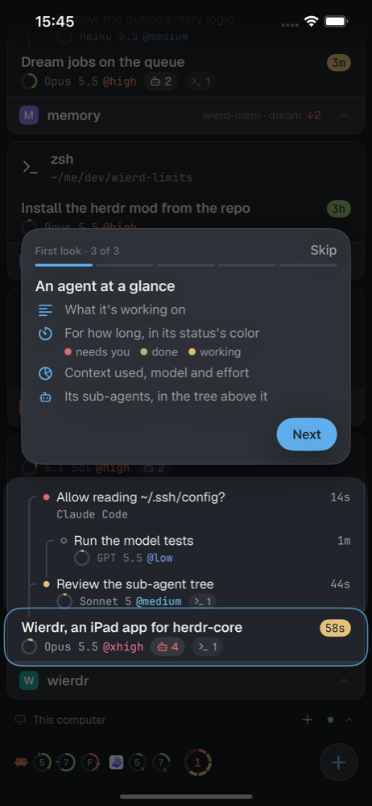

# Тур по приложению

Интерактивное обучение на демо: подсказка в карточке и указатель на экране, а каждое
действие ты делаешь сам (`App/Sources/Tutorial`). Сценариев два, по раскладке, в которой тур
начался: раскладка iPhone (iPhone и узкое окно iPad) и сплит iPad — сайдбар рядом с
панелями (ниже, «Сценарий iPad»). Окно, сменившее раскладку посреди тура, его заканчивает.

- **Начинается на экране хостов**: сам — при первом запуске (хостов нет и тур ещё не
  проходил); «Take the Tour» — под «Try the Demo» на экране хостов и в Settings (из живого
  подключения — отключает, тур всегда с экрана хостов; из демо — выходит из него). Первая
  карточка — «Welcome to Wierdr»: зачем приложение (агенты Herdr работают на Mac, Wierdr —
  в кармане: кто ждёт тебя, ответ в один тап, напрямую по SSH без сервера), «about 2
  minutes»; **Start Tour** или **Not Now**.
- **Как выглядит**: экран затемнён, кроме того, на что показывает шаг (вырез с акцентной
  обводкой: у шага с жестом она «дышит», у пояснения — тонкая и неподвижная), и того, что шаг
  показывает с ним (`spotlight`: Add Host рядом с Try the Demo, вся карточка спейса с её
  заголовком, дерево сабагентов над строкой агента, строка агента в панели под строкой его
  сабагента, терминал с ответом агента); места, куда ещё можно пальцем (терминал для свайпа
  назад, колонка клавиш), притемнены слегка; у шага «смахни панель» вырез — вся панель.
  Указатель — белая точка в акцентном кольце — через 0,7 с показывает жест на месте: тап,
  свайп вправо/влево (с Reduce Motion — стоит); на маленьких целях
  (кольцо статусов) он меньше и виден только вокруг тапа, на «‹» с бейджем и лимитах — у
  первой части. Карточка — у того, что показано (под ним в верхней половине экрана, иначе
  над; у того, что во весь экран, — внутри, под шапкой), не под клавиатурой и не поверх
  колонки клавиш (сужается рядом с ней); у поповера лимитов — над ним. На iPad места
  больше: карточка встаёт сбоку от того, что показано (справа, иначе слева), на его высоте
  — рядом со строкой сайдбара, кольцом, ⏎, поповером, всей панелью агентов; над панелью или
  полем сообщения — над их серединой.
- **Карточка**: глава и номер в ней («Someone needs you · 2 of 4»), сегмент на главу,
  **Skip**; заголовок, одна‑две фразы «что это и зачем», где нужно — список с метками
  (строка агента — с легендой статусов цветными точками, лимиты, итоговая памятка), мелкая
  приписка; внизу — что сделать («Tap the ring», «Swipe left on the terminal» у символа
  жеста) или **Next** у пояснений; сделал — на миг **✓ Done**, и результат виден на экране
  (сложенная карточка со сводкой, закреплённая строка). Шрифты — по Dynamic Type.
- **Делай сам**: палец проходит только в вырез (и в места, которые шаг добавляет); тап мимо —
  карточка вздрагивает, обводка вспыхивает; тап по подсвеченному у пояснения — как Next. Шаг
  идёт дальше сам, когда сделано; внутри шага действие следует за тобой: после свайпа строки —
  «Tap Pin» на кнопке, после тапа по полю — «Type anything, then send», пока агент отвечает —
  «It's answering…», колонка клавиш закрылась — «Swipe left for the keys again». Шаги, где
  ищешь в панели агентов и закрываешь то, что открыл (лимиты), ничего не затемняют и не блокируют. Меню, которое
  ты открыл сам по ходу (удержание строки, тап по заголовку панели), — без затемнения и
  подсказки, пока не закроешь. Если палец всё же увёл приложение не туда, подсказка прячется,
  и через 0,8 с тур возвращает экран на место; результат поиска открыл экран — шаги «Back to
  the agents» и «Back to your spaces»; если цель шага не появилась за 1,5 с — в карточке
  появляется Next.
- **Skip** спрашивает в той же карточке («End the tour? You can take it again from the host
  list or Settings.» — Continue / End Tour); после конца или пропуска сам тур больше не
  начинается.
- **Сценарий** (19 шагов, пять глав): Welcome → **First look**: тап «Try the Demo» (Add Host
  подсвечен: «Your Mac comes later»), **сложить карточку** wierd-limits (список снизу вверх,
  под большой палец; свёрнутая — с зелёным бейджем своего done), строка агента списком
  (заголовок, время в цвете статуса с легендой, контекст/модель/effort, сабагенты деревом
  над ней) → **Someone needs you**: **тап по кольцу статусов — панель агентов**, **тап по
  ждущему** (по статусам, ждущий — нижний со своим агентом; сабагент scout на месте
  родителя, спрашивает про чтение ~/.ssh/config — и в строке, и в терминале), **свайп
  влево — клавиши** (не закрывают терминал), **⏎ — разрешить**, **назад — в панель** (‹ с
  бейджем или свайп), **смахнуть панель — к спейсам** → **Talk to an agent**: **тап — экран агента** (размер под телефон,
  клик на Mac возвращает), **сообщение** (как набранное на Mac; скрепка — фото и файлы),
  **ответ и назад** (терминал не затемнён, пока агент отвечает; тап по заголовку — меню
  панели) → **Tidy and find**: **свайп вправо и Pin** (влево — Close, удержание — остальное;
  закреплённые внизу карточки и на Mac тоже), **кольцо — панель**, поиск («login»), смахнуть
  (открыл результат — назад в панель и смахнуть) →
  **Your limits**: **тап по лимитам**, поповер списком (дуга — доля по темпу, засечка —
  прошедшее время, 5/7/буква модели, ›› — быстрее времени), закрыть → **You're all set**:
  памятка жестов (свайп влево — клавиши, вправо — назад, кольцо — все агенты и поиск, удержание — меню,
  «+» — новый спейс, Settings, тур) и Live Activity; Add My Mac (выход из демо и редактор
  нового хоста; если хосты уже есть — Back to Hosts) или Keep Exploring (остаться в демо).
- **Сценарий iPad** (сплит; тоже 19 шагов, пять глав): Welcome («Wierdr brings them to your
  iPad») → **First look**: «Try the Demo», **сложить карточку** wierd-limits — шевроном
  (тап по заголовку на iPad выбирает спейс), строка агента (подсвечена, пока его панель
  впереди) → **Someone needs you**: **кольцо — панель агентов** в сайдбаре (поиск — и ⌘P),
  **тап по ждущему** — scout в своём окне над панелями, **свайп влево по его терминалу —
  клавиши**, **⏎**, **✕ — закрыть окно** (он работает дальше; Keep сделал бы его табом),
  **смахнуть панель** → **Talk to an agent**: **тап по агенту herdr-app** — его таб рядом
  со списком, со сплитом (с lazygit), **сообщение** из поля под панелями (оно пишет панели в
  фокусе), ответ в терминале (статус — в строке, на табе и в кольце; удержание таба —
  сплит, зум, закрыть) → **Make room**: **кнопка сайдбара слева от табов — скрыть его** (и
  ⌘B), **свайп вправо по терминалу — сайдбар поверх панелей, свайп влево — убрать**,
  **та же кнопка — вернуть его** → **Your limits** (как на iPhone) → **You're all set**:
  памятка (свайп влево — клавиши, вправо — скрытый сайдбар, кольцо, удержание, ⌘P, ⌘], ⌘B,
  «+») и Live Activity на iPhone.

Проверено (сборка 82): весь сценарий — в симуляторе iPhone 13 Pro Max (iOS 18.4, тёмная и
светлая тема; тап по подсвеченному как Next; подэтапы Pin, сообщения, ответа и закрытой колонки
клавиш; меню панели и строки по ходу; результат Go to и «Back to the list»; Skip) и на iPhone
13 Pro Max (iOS 27.2.1: из Settings живого подключения, все шаги, назад свайпом, Back to Hosts и
снова Connect).

Сценарий iPad: весь — в симуляторе iPad Pro 13" (M5, iOS 27, портрет, тёмная
тема), начало — и в альбомной; отдельные шаги с `-tour <id>`; дважды целиком на iPad Pro 13"
M4 (альбом, Release: из Settings живого подключения, все шаги, плавающая клавиатура в шаге
сообщения, Back to Hosts и снова Connect). Тур iPhone после этого — в симуляторе iPhone 18 Pro
Max (до ⏎ у scout).

Панель агентов вместо Go to: главы Someone needs you и Tidy and find пройдены в
симуляторе iPhone 13 Pro Max (iOS 27): кольцо → панель → scout → клавиши → ⏎ → назад в панель →
смахнуть; кольцо → «login» → результат → назад → смахнуть.
